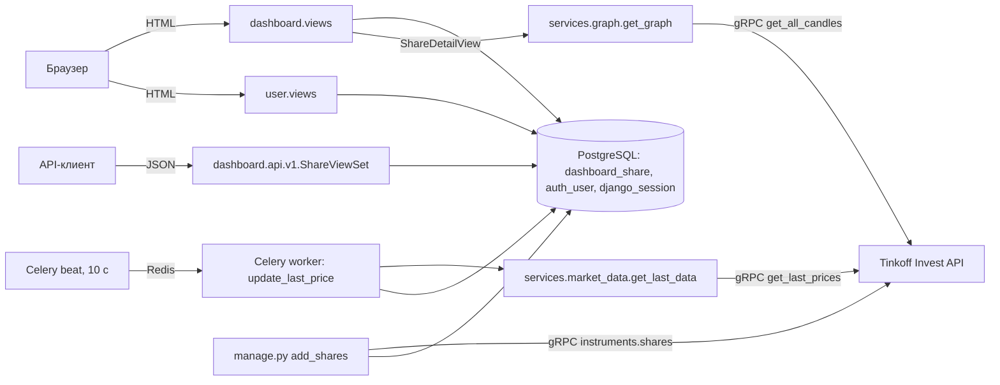

# ANALYSIS.md — Investing Demo

## 1. Анализ кода

Анализ выполнен только по исходному коду в репозитории, приложение не запускалось. Ссылки даны в формате `файл:строка` → функция или класс.

### 1.1. Назначение приложения и технологический стек

**Назначение.** Это веб-приложение, которое ведёт справочник акций и показывает по ним рыночные данные:

- список акций с текущей ценой и признаком роста или падения цены. Ячейка с ценой подсвечена зелёным или красным: `dashboard/templates/dashboard/list.html:35-40`, `dashboard/views.py:20` → `ShareListView`;
- карточка акции с графиком цен закрытия за последние 180 дней: `dashboard/views.py:29` → `ShareDetailView.get`, `dashboard/services/graph.py:11` → `get_graph`;
- создание, редактирование и удаление акций. Доступно только авторизованным пользователям: `dashboard/views.py:41-63` → `ShareCreateView`, `ShareUpdateView`, `ShareDeleteView`;
- REST API для CRUD-операций над акциями: `dashboard/api/v1/views.py:16` → `ShareViewSet`;
- регистрация, вход и выход пользователей: `user/views.py` → `AuthView`, `RegistrationView`, `LogoutView`;
- первичная загрузка справочника акций из Tinkoff Invest API: `dashboard/management/commands/add_shares.py:8` → `Command.handle`;
- периодическое обновление последней цены через Celery: `dashboard/tasks.py:7` → `update_last_price`, `config/celery.py:13` → `app.conf.beat_schedule`.

Источник рыночных данных — **Tinkoff Invest API** (gRPC SDK `tinkoff.invest`). Он используется в трёх местах:

- `dashboard/services/market_data.py` → `get_last_data`;
- `dashboard/services/graph.py` → `get_graph`;
- `dashboard/management/commands/add_shares.py` → `Command.handle`.

Токен хранится в `config/settings.py:134` → `TINKOFF_TOKEN` и там пустой.

**Технологический стек**

| Слой | Технология | Где видно |
|---|---|---|
| Язык | Python 3 | `manage.py`, все `*.py` |
| Веб-фреймворк | Django 4.1.7 | `requirements.txt:13`; комментарии в миграциях `dashboard/migrations/0001_add_share.py:1` |
| REST API | Django REST Framework 3.14 + django-filter 22.1 | `requirements.txt:15-16`; `config/settings.py:31` → `REST_FRAMEWORK` |
| СУБД | PostgreSQL (драйвер psycopg2-binary) | `config/settings.py:91` → `DATABASES`; `docker-compose.yml:3` → сервис `db` |
| Фоновые задачи | Celery 5.2.7 (worker + beat) | `config/celery.py`, `dashboard/tasks.py` |
| Брокер сообщений | Redis | `config/settings.py:141` → `CELERY_BROKER_URL`; `docker-compose.yml:16` → сервис `redis` |
| Рыночные данные | `tinkoff-investments==0.2.0b50` (gRPC, protobuf) | `requirements.txt:36`, `dashboard/services/*.py` |
| Графики | Plotly 5.13 (`plotly.offline.plot`, вывод HTML-`div`) | `dashboard/services/graph.py:21` |
| UI | Шаблоны Django, Bootstrap 5.1.3 (локальная статика), django-crispy-forms 2.0 с пакетом шаблонов `bootstrap3` | `dashboard/templates/**`, `dashboard/static/dashboard/css/bootstrap.min.css`, `config/settings.py:28-29` |
| Инфраструктура | Docker Compose (только PostgreSQL и Redis, контейнера с приложением нет) | `docker-compose.yml` |
| Тесты | DRF `APITestCase` | `dashboard/tests.py:8` → `DashboardTests` |

### 1.2. Структура проекта и основные компоненты

```
config/                Django-проект (настройки, корневой роутинг, Celery, WSGI/ASGI)
  settings.py          настройки: приложения, БД, DRF, логирование, Celery, TINKOFF_TOKEN
  urls.py              корневой URLconf
  celery.py            экземпляр Celery и расписание beat
  __init__.py          экспорт celery_app (загрузка Celery при старте Django)
  wsgi.py / asgi.py    точки входа WSGI/ASGI
dashboard/             основное приложение «акции»
  models.py            модель Share
  views.py             HTML-представления (CBV) и миксин доступа
  forms.py             ShareModelForm
  urls.py              маршруты HTML-части и подключение API
  admin.py             регистрация Share в админке
  tasks.py             Celery-задача update_last_price
  services/
    market_data.py     получение последней цены (Tinkoff)
    graph.py           построение графика свечей (Tinkoff + Plotly)
  api/                 REST API: версия v1 (router, serializer, views, urls)
  management/commands/add_shares.py   команда загрузки справочника акций
  migrations/0001..0007               история схемы таблицы Share
  templates/dashboard/  base, list, detail, create, delete
  static/dashboard/css/ bootstrap.min.css, sticky-footer-navbar.css
  tests.py             тесты REST API и главной страницы
user/                  приложение аутентификации
  models.py            алиас User = get_user_model() (своих моделей нет)
  forms.py             RegistrationForm, AuthForm
  views.py             AuthView, RegistrationView, LogoutView
  urls.py              login/, registration/, logout/
  templates/user/      base, auth, registration
  static/user/css/     bootstrap.min.css, signin.css
docker-compose.yml     PostgreSQL + Redis
requirements.txt       зафиксированные версии зависимостей
README.md              инструкции по запуску
```

**Компоненты и их назначение**

| Компонент | Файл → класс/функция | Назначение |
|---|---|---|
| Настройки | `config/settings.py` | `INSTALLED_APPS` (стр. 13), `DATABASES` (стр. 91), `REST_FRAMEWORK` (стр. 31), `LOGGING` + глобальный `logger` (стр. 37, 59), `TINKOFF_TOKEN` (стр. 134), `CELERY_*` (стр. 137-144) |
| Корневой роутинг | `config/urls.py:4` → `urlpatterns` | `admin/` → админка; `""` → `dashboard.urls`; `"user"` → `user.urls` |
| Celery-приложение | `config/celery.py:7` → `app` | конфигурация из настроек с префиксом `CELERY`, `autodiscover_tasks()`, расписание `beat_schedule` |
| Модель акции | `dashboard/models.py:4` → `Share` | единственная прикладная сущность |
| HTML CRUD | `dashboard/views.py` → `ShareListView`, `ShareDetailView`, `ShareCreateView`, `ShareUpdateView`, `ShareDeleteView` | веб-интерфейс |
| Контроль доступа | `dashboard/views.py:11` → `IsUserAuthenticatedMixin` | `test_func` проверяет `is_authenticated`, `handle_no_permission` перенаправляет на `dashboard:index` |
| Форма акции | `dashboard/forms.py:6` → `ShareModelForm` | `ModelForm` со всеми редактируемыми полями (`fields="__all__"`) |
| REST API | `dashboard/api/v1/views.py:16` → `ShareViewSet`; `serializer.py:6` → `ShareSerializer`; `router.py:5` → `DefaultRouter` | CRUD `/api/v1/shares/` с фильтрацией, поиском и сортировкой |
| Сервис цен | `dashboard/services/market_data.py:6` → `get_last_data` | последняя цена по FIGI |
| Сервис графика | `dashboard/services/graph.py:11` → `get_graph` | дневные свечи за 180 дней → Plotly `div` |
| Фоновое обновление | `dashboard/tasks.py:7` → `update_last_price` | обходит все акции и сохраняет `last_price` и `is_trend_high` |
| Импорт справочника | `dashboard/management/commands/add_shares.py:8` → `Command` | `python manage.py add_shares` |
| Админка | `dashboard/admin.py:6` → `ShareAdmin` | список, поиск и форма редактирования акций |
| Аутентификация | `user/views.py`, `user/forms.py` | вход, регистрация и выход на основе `django.contrib.auth` |

### 1.3. Архитектура и взаимодействие компонентов

Это монолитное Django-приложение по схеме MTV (Model–Template–View). Логика работы с внешним API вынесена в простой сервисный слой `dashboard/services`. Приложение работает в трёх процессах:

1. **Веб-процесс Django** (`config/wsgi.py` → `application`). Отдаёт HTML-страницы и REST API.
2. **Celery beat** (`config/celery.py:13` → `beat_schedule`). Каждые **10 секунд** ставит в очередь задачу `dashboard.tasks.update_last_price`. Ключ расписания называется `"add-every-5-min"`, но значение `schedule` равно `10.0` секундам.
3. **Celery worker**. Выполняет `update_last_price` (`dashboard/tasks.py:7`). Брокер — Redis (`config/settings.py:141`).

Есть и разовый процесс: management-команда `add_shares`.



**Ключевые взаимодействия**

- **Цена хранится в БД, график строится на лету.** Страница списка читает `last_price` и `is_trend_high` из БД (`list.html:35-40`), а эти поля пишет фоновая задача (`tasks.py:24` → `Share.objects.filter(id=...).update(...)`). Страница карточки при каждом запросе синхронно обращается к Tinkoff за свечами (`views.py:37` → `get_graph(share)`). Исторические цены в БД не сохраняются.
- **Как вычисляется тренд.** Функция `update_last_price` сравнивает ранее сохранённую `share.last_price` с новой ценой. Если старая цена больше новой, записывается `is_trend_high=False`, иначе `True`. Если старой цены нет, сравнение с `None` бросает исключение, оно логируется и `is_trend_high` становится `True` (`tasks.py:15-22`).
- **Что работает без доступа к Tinkoff Invest API** (например, при пустом `TINKOFF_TOKEN`):
  - **Список акций** (`ShareListView`), CRUD-формы, админка и REST API работают. Они читают и пишут только БД и к Tinkoff не обращаются. Колонка «Текущая цена» при этом остаётся пустой: `update_last_price` падает на каждой акции, исключение логируется (`tasks.py:27-28`), и `last_price` не заполняется.
  - **Страница акции** (`ShareDetailView.get`) не работает. Она безусловно вызывает `get_graph(share)` (`views.py:37`), а ошибка gRPC-клиента в `get_graph` (`graph.py:12-18`) нигде не перехватывается, поэтому пользователь получает HTTP 500.
  - **Команда `add_shares`** не работает, а без неё справочник акций изначально пуст.
- **Точность цены.** И `get_last_data` (`market_data.py:11` → `resp.price.units`), и `get_graph` (`graph.py:20` → `candle.close.units`) берут только целую часть `Quotation`. Дробная часть (`nano`) отбрасывается.
- **Поле `updated_at` не меняется при обновлении цены.** `QuerySet.update()` в `tasks.py:24` не вызывает `save()`, поэтому `auto_now` у `updated_at` (`models.py:17`) не срабатывает. Поле меняется только при сохранении через форму, админку или API.
- **Логирование.** Используется общий объект `logger` из `config/settings.py:59`. Его напрямую импортируют `dashboard/tasks.py:4` и `dashboard/services/market_data.py:3`. Логи пишутся в консоль и в файл `app.logs` (`settings.py:48-52`).
- **Загрузка Celery вместе с Django.** Файл `config/__init__.py:1` импортирует `celery_app`, поэтому `@app.task` регистрируется при загрузке Django.

**Маршрутизация (итоговые URL)**

| URL | Обработчик | Имя маршрута |
|---|---|---|
| `/` | `dashboard.views.ShareListView` | `dashboard:index` |
| `/<pk>` | `dashboard.views.ShareDetailView` | `dashboard:detail` |
| `/create` | `dashboard.views.ShareCreateView` | `dashboard:create` |
| `/update/<pk>` | `dashboard.views.ShareUpdateView` | `dashboard:update` |
| `/delete/<pk>` | `dashboard.views.ShareDeleteView` | `dashboard:delete` |
| `/api/v1/` | корень `DefaultRouter` | `api-root` |
| `/api/v1/shares/`, `/api/v1/shares/<pk>/` | `dashboard.api.v1.views.ShareViewSet` | `share-list`, `share-detail` |
| `/userlogin/` | `user.views.AuthView` | `user:auth` |
| `/userregistration/` | `user.views.RegistrationView` | `user:registration` |
| `/userlogout/` | `user.views.LogoutView` | `user:logout` |
| `/admin/` | `django.contrib.admin` | — |

Маршрут `/api/` подключён внутри `dashboard/urls.py:19`, а не в корневом URLconf. Маршруты пользователя склеиваются без слэша, получается `/userlogin/`, потому что в `config/urls.py:7` указан префикс `path("user", ...)` без завершающего `/`.

### 1.4. Библиотеки и внешние зависимости

**Python-пакеты** (`requirements.txt`). Напрямую в коде используются:

| Пакет | Версия | Где используется |
|---|---|---|
| Django | 4.1.7 | весь проект |
| djangorestframework | 3.14.0 | `dashboard/api/v1/*`, `dashboard/tests.py` |
| django-filter | 22.1 | `dashboard/api/v1/views.py:1` → `ShareFilter`, `DjangoFilterBackend` |
| django-crispy-forms | 2.0 | `config/settings.py:20`; `dashboard/templates/dashboard/create.html:8` → `as_crispy_field` |
| crispy-bootstrap3 | 2022.1 | `config/settings.py:21, 28-29` (пакет шаблонов форм) |
| celery | 5.2.7 | `config/celery.py`, `dashboard/tasks.py` |
| redis | 4.5.1 | транспорт брокера Celery (`CELERY_BROKER_URL`) |
| psycopg2-binary | 2.9.5 | драйвер `django.db.backends.postgresql` |
| plotly | 5.13.1 | `dashboard/services/graph.py:3-4` |
| tinkoff-investments | 0.2.0b50 | `tinkoff.invest.Client`, `CandleInterval`, `utils.now` в `services/*.py` и `add_shares.py` |
| grpcio, protobuf | 1.51.3, 3.20.3 | транзитивные зависимости `tinkoff-investments` |

Остальное — транзитивные зависимости: `amqp`, `kombu`, `billiard`, `vine`, `click*` от Celery; `asgiref`, `sqlparse` от Django; `pydantic`, `cachetools`, `python-dateutil` и другие. Кроме того, в файл попали инструменты разработчика `black`, `isort`, `mypy-extensions`, `pathspec`, `platformdirs`, `tomli` и пакет `tinkoff==0.1.1`, который в коде не импортируется. Пакет `eventlet` упомянут в `README.md:19` для запуска worker под Windows, но в `requirements.txt` его нет.

**Внешние сервисы и инфраструктура**

- PostgreSQL: `docker-compose.yml:3` → `db`, образ `postgres` без фиксированной версии, БД `investing`, пользователь и пароль `postgres/postgres`, порт 5432. Тома для данных нет; вместо него каталог проекта смонтирован в `/app` контейнера БД (`docker-compose.yml:13-14`).
- Redis: `docker-compose.yml:16` → `redis`, образ `redis`, порт 6379.
- Tinkoff Invest API: сетевой gRPC-доступ по токену `TINKOFF_TOKEN`.

**Внешние фронтенд-ресурсы (CDN)**, `dashboard/templates/dashboard/base.html:10-24`:

- `plotly-latest.min.js`;
- jQuery 3.3.1 slim;
- Popper 1.14.6;
- Font Awesome 4.7.0;
- Moment.js 2.23.0;
- Tempus Dominus Bootstrap 4 5.1.2.

Bootstrap 5.1.3 лежит локально в двух копиях: `dashboard/static/dashboard/css/bootstrap.min.css` и `user/static/user/css/bootstrap.min.css`.

### 1.5. Модель данных

**Сущность `Share` (акция).** Таблица `dashboard_share`, класс `dashboard/models.py:4`. В `Meta` заданы `verbose_name="Акция"` и `verbose_name_plural="Акции"`.

| Атрибут | Тип | Ограничения | Назначение |
|---|---|---|---|
| `id` | `BigAutoField` | PK (`dashboard/apps.py:5`, `settings.py:132`) | суррогатный ключ |
| `figi` | `CharField(255)` | `unique=True` | идентификатор инструмента FIGI, по нему идут запросы к Tinkoff |
| `isin` | `CharField(255)` | обязательное | международный код ISIN |
| `name` | `CharField(255)` | обязательное | «Наименование компании» |
| `ticker` | `CharField(10)` | `unique=True` | «Тикер» |
| `currency` | `CharField(20)` | обязательное | «Валюта» |
| `uid` | `CharField(255)` | `unique=True`, обязательное | внутренний UID инструмента в Tinkoff |
| `last_price` | `FloatField` | `null=True, blank=True` | «Текущая цена» |
| `is_trend_high` | `BooleanField` | `null=True, blank=True` | «Растет цена»: направление последнего изменения |
| `updated_at` | `DateTimeField(auto_now=True)` | `null=True, blank=True` | время последнего сохранения через `save()` |

Схема складывалась миграциями:

- `0001_add_share`: базовые поля;
- `0002_update_share`: уникальность `figi` и `ticker`;
- `0003_add_uuid`: поле `uid`;
- `0004_add_last_price`: поля `last_price` и `is_trend_high`;
- `0005`, `0006`: только `verbose_name`;
- `0007_add_updated_at`: поле `updated_at`.

**Пользователь.** Своей модели нет. `user/models.py:3` → `User = get_user_model()`, то есть используется стандартная `django.contrib.auth.models.User` (таблица `auth_user`). При регистрации email записывается и в `username`, и в `email`: `user/forms.py:51` → `User.objects.create_user(email, email, password)`.

**Связи.** Между `Share` и `User` связей нет: ни одного `ForeignKey`, `ManyToMany` или `OneToOne` в проекте. Пользователи не владеют акциями, все акции общие. Прочие таблицы стандартные для подключённых `django.contrib.*`: сессии, права, `contenttypes`, журнал админки.

### 1.6. Обработка пользовательских запросов и взаимодействие с БД

**Общий конвейер.** Запрос проходит стандартный список `MIDDLEWARE` (`config/settings.py:61`): Security, Session, Common, CSRF, Authentication, Messages, XFrame. Затем он попадает в URLconf (`config/urls.py`) и в CBV или ViewSet. Доступ к БД идёт только через Django ORM; «сырого» SQL в проекте нет.

**HTML-часть (`dashboard/views.py`)**

| Представление | Запрос | Работа с БД и логика |
|---|---|---|
| `ShareListView` (`ListView`) | GET `/` | `Share.objects.order_by("name")` (`ordering`), пагинация по 100 записей (`paginate_by`), шаблон `list.html`. Кнопки управления видны только при `user.is_authenticated` |
| `ShareDetailView.get` | GET `/<pk>` | `Share.objects.get(id=pk)` (`views.py:32`). Если записи нет, `DoesNotExist` не перехватывается, и ответ будет 500, а не 404. Затем вызывается `get_graph(share)` с запросом к Tinkoff. HTML графика выводится через `` (`detail.html:23`) |
| `ShareCreateView` (`CreateView`) | GET/POST `/create` | Проверка `IsUserAuthenticatedMixin`. При POST `ShareModelForm` проверяет данные (обязательность, уникальность `figi`/`ticker`/`uid`) и выполняет `form.save()`, то есть INSERT. Затем редирект на `dashboard:index` |
| `ShareUpdateView` (`UpdateView`) | GET/POST `/update/<pk>` | `get_object()` по `pk` (404, если записи нет), валидация формы, `save()` (UPDATE, обновляет `updated_at`) |
| `ShareDeleteView` (`DeleteView`) | GET/POST `/delete/<pk>` | GET показывает подтверждение (`delete.html`), POST выполняет DELETE |

Неавторизованный пользователь на защищённых страницах не получает 403: `IsUserAuthenticatedMixin.handle_no_permission` (`views.py:15-17`) молча перенаправляет его на главную.

**REST API (`dashboard/api/v1/views.py:16` → `ShareViewSet`, `ModelViewSet`)**

- Методы: `list`, `retrieve`, `create`, `update`, `partial_update`, `destroy` на `/api/v1/shares/` и `/api/v1/shares/<pk>/`. Набор записей — `Share.objects.all()`.
- Сериализация: `ShareSerializer` (`serializer.py:6`) отдаёт поля `id, figi, isin, name, ticker, currency, last_price, is_trend_high, updated_at`. Поля `uid` в нём нет. При создании через API оно получает значение по умолчанию `""`, поэтому вторая запись, созданная через API, нарушит `unique` у `uid`.
- Фильтрация, поиск, сортировка: `ShareFilter` (`views.py:10`) фильтрует по точному совпадению `name` и `ticker` (`?name=`, `?ticker=`); `OrderingFilter` сортирует по `name` и `ticker` (`?ordering=`); `SearchFilter` с `search_fields=["$name"]` ищет по регулярному выражению в `name` (`?search=`).
- Пагинация: `LimitOffsetPagination` с `PAGE_SIZE=100` (`config/settings.py:32-33`). Ответ имеет вид `{count, next, previous, results}`.
- Права доступа: `permission_classes` не заданы, и в `REST_FRAMEWORK` нет `DEFAULT_PERMISSION_CLASSES`. Значит, действует `AllowAny`: анонимный клиент может создавать, изменять и удалять акции через API, хотя в HTML-части те же операции закрыты `IsUserAuthenticatedMixin`.
- Это поведение (CRUD, 201, 204, 400, 404) проверяется тестами `dashboard/tests.py` → `DashboardTests.test_share_*`.

**Аутентификация (`user/views.py`, `user/forms.py`)**

- `AuthView.post`: форма `AuthForm` не проверяется (`is_valid()` не вызывается). Значения берутся из `form.data`, email приводится к нижнему регистру, затем вызываются `authenticate(...)` и `login(...)`. Последний — запись в `django_session`. После этого редирект на `dashboard:index` или повторный показ формы с ошибкой.
- `RegistrationView.post`: `RegistrationForm.is_valid()` → `clean()` проверяет совпадение паролей и уникальность email (`User.objects.filter(email=email)`). Затем `save()` вызывает `create_user` (INSERT в `auth_user`) и `authenticate`, после чего выполняется `login` и редирект. Особенности:
  - email при регистрации не приводится к нижнему регистру, а при входе приводится (`AuthView.post`);
  - `AUTH_PASSWORD_VALIDATORS` в форме не применяются;
  - при ошибке только в отдельном поле, без общей ошибки формы, `form.errors["__all__"]` (`user/views.py:54`) и `self.cleaned_data["email"]` (`user/forms.py:32`) могут бросить `KeyError`.
- `LogoutView.get`: выполняет `logout(request)` (удаляет сессию) и редирект.

**Фоновые и пакетные операции с БД**

- `update_last_price` (`dashboard/tasks.py:7`): один SELECT `Share.objects.all()`, затем для каждой акции отдельный gRPC-запрос и отдельный `UPDATE ... WHERE id=` (`tasks.py:24`). Получается N+1 запросов к API и N UPDATE за запуск, раз в 10 секунд. Ошибки по каждой акции логируются и не прерывают цикл.
- `add_shares` (`add_shares.py:15`): для каждого инструмента из `client.instruments.shares()` вызывается `Share.objects.get_or_create(...)` по всем шести полям сразу. Если любой атрибут инструмента изменился, `get_or_create` попробует вставить новую строку и упадёт на `unique` по `figi`, `ticker` или `uid`. Транзакции и обработки ошибок нет.

**Конфигурационные моменты, влияющие на запуск**

- `SECRET_KEY = ""` (`config/settings.py:6`): Django не стартует с пустым ключом.
- `TINKOFF_TOKEN = ""` (`settings.py:134`): все обращения к Tinkoff будут отклонены. При этом по условиям задания токен Т-Инвестиций недоступен, и источником данных должно стать публичное API Мосбиржи ISS.
- Параметры БД (`settings.py:96-103`) и брокера (`settings.py:141`) жёстко прописаны в коде, переменные окружения не используются.
- `DEBUG = True` и пустой `ALLOWED_HOSTS` (`settings.py:8-10`).

## 2. Функциональные требования

Требования восстановлены по исходному коду и описывают **фактически реализованное** поведение, а не желаемое. Выявленные дефекты и противоречия вынесены в раздел 2.5 и требованиями не считаются. Ссылки даны в формате `файл:строка → класс/функция`.

### 2.1. Основные функциональные возможности

1. Просмотр списка акций с текущей ценой и индикатором направления её изменения. Доступен всем.
2. Просмотр карточки акции с графиком дневных цен закрытия за 180 дней. Доступен всем.
3. Добавление, редактирование и удаление акций через веб-интерфейс. Только для авторизованных пользователей.
4. REST API `/api/v1/shares/`: CRUD с фильтрацией, поиском, сортировкой и пагинацией.
5. Регистрация, вход и выход пользователей по email и паролю.
6. Администрирование справочника акций через Django Admin.
7. Первичная загрузка справочника акций из Tinkoff Invest API (management-команда).
8. Периодическое автоматическое обновление последней цены и признака тренда (Celery).

### 2.2. Сценарии взаимодействия пользователя

**UC-1. Анонимный посетитель просматривает акции.**
1. Посетитель открывает `/` и видит таблицу акций, отсортированную по названию, по 100 акций на странице.
2. Посетитель переходит по тикеру на страницу `/<id>`.
3. Система показывает название, цену, время обновления и график.

В шапке видна кнопка «Войти». Кнопок «Добавить», «Редактировать» и «Удалить» нет. Код: `dashboard/views.py` → `ShareListView`, `ShareDetailView`; `dashboard/templates/dashboard/list.html`, `base.html`.

**UC-2. Регистрация.**
1. Посетитель нажимает «Войти», затем «Зарегистрироваться» и попадает на `/userregistration/`.
2. Вводит email и дважды пароль.
3. Если данные корректны, система создаёт пользователя, сразу авторизует его и перенаправляет на главную. Иначе снова показывает форму с текстом ошибки.

Код: `user/views.py` → `RegistrationView`.

**UC-3. Вход и выход.**
1. Пользователь вводит email и пароль на `/userlogin/`.
2. При успехе система перенаправляет его на главную, где в шапке отображается «Привет, <email>» и кнопка «Выход».
3. «Выход» (`/userlogout/`) завершает сессию и возвращает на главную.

Код: `user/views.py` → `AuthView`, `LogoutView`.

**UC-4. Авторизованный пользователь управляет акциями.**
- «Добавить» открывает `/create`: форма со всеми полями акции, кнопка «Сохранить», после сохранения возврат к списку.
- «Редактировать» открывает `/update/<id>`: та же форма, заполненная текущими значениями.
- «Удалить» открывает `/delete/<id>`: страница подтверждения, после подтверждения возврат к списку.

Код: `dashboard/views.py` → `ShareCreateView`, `ShareUpdateView`, `ShareDeleteView`.

**UC-5. Внешний клиент работает через REST API.** Клиент выполняет `GET`, `POST`, `PUT`, `PATCH` и `DELETE` на `/api/v1/shares/` и `/api/v1/shares/<id>/` и получает JSON. Код: `dashboard/api/v1/views.py` → `ShareViewSet`.

**UC-6. Администратор/оператор.**
1. Выполняет `python manage.py add_shares`, чтобы загрузить справочник.
2. Запускает Celery beat и worker, чтобы цены обновлялись.
3. Редактирует акции в `/admin/`.

Код: `dashboard/management/commands/add_shares.py`, `config/celery.py`, `dashboard/admin.py`.

### 2.3. Бизнес-правила, проверки и ограничения

| № | Правило | Где в коде |
|---|---|---|
| BR-1 | FIGI акции уникален, до 255 символов, обязателен | `dashboard/models.py:7` → `Share.figi` |
| BR-2 | Тикер уникален, до 10 символов, обязателен | `dashboard/models.py:10` → `Share.ticker` |
| BR-3 | UID акции уникален, до 255 символов, обязателен в форме и админке | `dashboard/models.py:12` → `Share.uid` |
| BR-4 | ISIN (до 255) и наименование (до 255) обязательны; валюта обязательна, до 20 символов | `dashboard/models.py:8-11` |
| BR-5 | Цена (`last_price`) и признак роста (`is_trend_high`) необязательны и могут быть пустыми | `dashboard/models.py:13-16` |
| BR-6 | `updated_at` выставляется автоматически при каждом сохранении записи через `save()` и вручную не редактируется | `dashboard/models.py:17` (`auto_now=True`) |
| BR-7 | Признак тренда: если новая цена меньше сохранённой, тренд «падает» (`False`); если больше **или равна**, тренд «растёт» (`True`); если сохранённой цены нет, тренд «растёт» (`True`) | `dashboard/tasks.py:15-22` → `update_last_price` |
| BR-8 | Создавать, редактировать и удалять акции через веб-интерфейс может только аутентифицированный пользователь; иначе выполняется перенаправление на главную | `dashboard/views.py:11-17` → `IsUserAuthenticatedMixin` |
| BR-9 | Для регистрации пароль и его подтверждение должны совпадать | `user/forms.py:35-37` → `RegistrationForm.clean` |
| BR-10 | Email при регистрации должен быть уникальным среди пользователей | `user/forms.py:39-46` → `RegistrationForm.clean` |
| BR-11 | Email используется как логин: он сохраняется и в `username`, и в `email` | `user/forms.py:51` → `RegistrationForm.save` |
| BR-12 | При входе email приводится к нижнему регистру | `user/views.py:19` → `AuthView.post` |
| BR-13 | Список акций в вебе: сортировка по названию, 100 записей на страницу | `dashboard/views.py:25-26` → `ShareListView` |
| BR-14 | Список в API: `limit/offset`, по умолчанию 100 записей | `config/settings.py:31-35` → `REST_FRAMEWORK` |
| BR-15 | График строится по дневным свечам за последние 180 дней, по целой части цены закрытия | `dashboard/services/graph.py:14-20` → `get_graph` |
| BR-16 | Цена обновляется по расписанию каждые 10 секунд | `config/celery.py:13-18` → `beat_schedule` |
| BR-17 | Ошибка получения цены по одной акции не прерывает обновление остальных: она логируется | `dashboard/tasks.py:27-28` → `update_last_price` |
| BR-18 | Все изменяющие операции веб-интерфейса защищены CSRF-токеном | `config/settings.py:65` (`CsrfViewMiddleware`); `` в `create.html`, `delete.html`, `auth.html`, `registration.html` |

### 2.4. Функциональные требования

**Список и просмотр акций**

- **FR-1.** По адресу `/` система отображает всем пользователям, включая анонимных, таблицу акций из БД с колонками «Тикер», «Название», «ISIN», «Текущая цена». Код: `dashboard/views.py:20` → `ShareListView`; `dashboard/templates/dashboard/list.html:16-58`.
- **FR-2.** Список акций сортируется по полю «Наименование» по возрастанию. Код: `dashboard/views.py:26` → `ShareListView.ordering`.
- **FR-3.** Список разбит на страницы по 100 акций. Под таблицей есть навигация: ««», номера страниц с выделением текущей, «»». Переход выполняется параметром `?page=N`. Код: `dashboard/views.py:25` → `ShareListView.paginate_by`; `list.html:60-80`.
- **FR-4.** Ячейка «Текущая цена» показывает значение `last_price` и валюту. Если `is_trend_high` истинно, фон ячейки зелёный (`mediumseagreen`), иначе красный (`palevioletred`). Код: `list.html:35-40`.
- **FR-5.** Если в БД нет акций, вместо таблицы выводится текст «Акций еще нет». Код: `list.html:83-85`.
- **FR-6.** Тикер в списке является ссылкой на страницу акции `/<id>`. Код: `list.html:32`; `dashboard/urls.py:15` → `dashboard:detail`.
- **FR-7.** Страница акции `/<id>` доступна всем. Она показывает наименование, текущую цену с валютой и время последнего сохранения записи (`updated_at`). Код: `dashboard/views.py:29-38` → `ShareDetailView.get`; `detail.html:11-13`.
- **FR-8.** На странице акции выводится раздел «Исторические данные» с линейным графиком Plotly. По оси X идут даты, по оси Y — цена закрытия (целая часть) дневных свечей Tinkoff Invest API за последние 180 дней по FIGI акции. Данные запрашиваются при каждом открытии страницы. Код: `dashboard/services/graph.py:11` → `get_graph`; `detail.html:22-25`.

**Управление акциями (веб)**

- **FR-9.** Кнопка «Добавить» над списком и колонка «Управление» с кнопками «Редактировать» и «Удалить» отображаются только аутентифицированному пользователю. Код: `list.html:9-13, 23-25, 41-50`.
- **FR-10.** Аутентифицированный пользователь может добавить акцию на странице `/create`. В форме есть поля FIGI, ISIN, «Наименование компании», «Тикер», «Валюта», UID, «Текущая цена», «Растет цена». После успешного сохранения выполняется переход на главную. Код: `dashboard/views.py:41-46` → `ShareCreateView`; `dashboard/forms.py:6` → `ShareModelForm`; `create.html`.
- **FR-11.** При сохранении формы акции система проверяет обязательность полей, их максимальную длину и уникальность FIGI, тикера и UID (BR-1…BR-5). При ошибке форма показывается повторно с сообщениями у полей. Код: `dashboard/forms.py:6` → `ShareModelForm`; `dashboard/models.py:4` → `Share`.
- **FR-12.** Аутентифицированный пользователь может отредактировать акцию на странице `/update/<id>`. Форма та же, что при создании, и заполнена текущими значениями. Если акции нет, возвращается 404. После сохранения выполняется переход на главную, `updated_at` обновляется. Код: `dashboard/views.py:49-55` → `ShareUpdateView`.
- **FR-13.** Аутентифицированный пользователь может удалить акцию. GET `/delete/<id>` показывает вопрос «Вы уверены, что хотите удалить инструмент: "<название>"?» и кнопку «Удалить». POST удаляет запись и выполняет переход на главную. Если акции нет, возвращается 404. Код: `dashboard/views.py:58-63` → `ShareDeleteView`; `delete.html`.
- **FR-14.** Неаутентифицированный пользователь при обращении к `/create`, `/update/<id>` или `/delete/<id>` любым методом перенаправляется на главную `/` без сообщения об ошибке. Код: `dashboard/views.py:11-17` → `IsUserAuthenticatedMixin.test_func`, `handle_no_permission`.

**REST API**

- **FR-15.** `GET /api/v1/shares/` возвращает список акций в формате `{count, next, previous, results}` с пагинацией `limit/offset`, по умолчанию 100 записей. Каждый элемент содержит `id, figi, isin, name, ticker, currency, last_price, is_trend_high, updated_at`. Код: `dashboard/api/v1/views.py:16` → `ShareViewSet`; `serializer.py:6` → `ShareSerializer`; `config/settings.py:32-33`.
- **FR-16.** Список в API поддерживает:
  - фильтрацию по точному значению `?name=` и `?ticker=` (`dashboard/api/v1/views.py:10` → `ShareFilter`);
  - поиск по названию регулярным выражением `?search=` (`search_fields=["$name"]`);
  - сортировку `?ordering=name|ticker|-name|-ticker` (`ordering_fields`).
- **FR-17.** `GET /api/v1/shares/<id>/` возвращает одну акцию или 404, если её нет. Код: `ShareViewSet` (retrieve); тесты `dashboard/tests.py` → `test_share_detail`, `test_share_detail_invalid`.
- **FR-18.** `POST /api/v1/shares/` создаёт акцию и возвращает 201 с созданным объектом. Поля `figi, isin, name, ticker, currency` обязательны, `last_price` и `is_trend_high` необязательны. Если не хватает обязательных полей или нарушена уникальность `figi`/`ticker`, возвращается 400. Код: `ShareViewSet` (create), `ShareSerializer`; тесты `test_share_create`, `test_share_create_invalid`.
- **FR-19.** `PUT /api/v1/shares/<id>/` полностью обновляет акцию и возвращает 200, при неполных данных — 400. `PATCH` обновляет акцию частично. Код: `ShareViewSet` (update/partial_update); тесты `test_share_update`, `test_share_update_invalid`.
- **FR-20.** `DELETE /api/v1/shares/<id>/` удаляет акцию и возвращает 204, а если акции нет — 404. Код: `ShareViewSet` (destroy); тесты `test_share_delete`, `test_share_delete_invalid`.
- **FR-21.** Поля `id` и `updated_at` в API доступны только для чтения. Код: `ShareSerializer` (`id` — первичный ключ, `updated_at` — `auto_now`, оба DRF делает read-only).
- **FR-22.** Операции API не требуют аутентификации, потому что права доступа не настроены (`AllowAny` DRF по умолчанию). Код: `dashboard/api/v1/views.py:16` → `ShareViewSet`; `config/settings.py:31-35`. Противоречие с FR-14 описано в D-6.
- **FR-23.** `GET /api/v1/` возвращает корневую страницу API (browsable API) со ссылкой на ресурс `shares`. Код: `dashboard/api/v1/router.py:5` → `routers.DefaultRouter`.

**Пользователи**

- **FR-24.** Страница регистрации `/userregistration/` содержит поля «Email», «Пароль», «Повторите пароль» и ссылку «Войти». Код: `user/views.py:36-41` → `RegistrationView.get`; `user/forms.py:8` → `RegistrationForm`; `registration.html`.
- **FR-25.** При регистрации система проверяет:
  - email корректен;
  - все поля заполнены;
  - пароли совпадают, иначе ошибка «Введенные пароли не совпадают»;
  - email ещё не зарегистрирован, иначе ошибка «Данный e-mail уже зарегистрирован! …».

  Ошибка выводится под полями формы. Код: `user/forms.py:30-46` → `RegistrationForm.clean`; `user/views.py:50-55` → `RegistrationView.post`.
- **FR-26.** После успешной регистрации система создаёт пользователя с `username=email` и `email=email`, автоматически выполняет вход и перенаправляет на главную. Код: `user/forms.py:48-53` → `RegistrationForm.save`; `user/views.py:46-49` → `RegistrationView.post`.
- **FR-27.** Страница входа `/userlogin/` содержит поля «Email», «Пароль» и ссылку «Зарегистрироваться». Система ищет пользователя по `username`, равному email в нижнем регистре, и проверяет пароль. При успехе создаётся сессия и выполняется переход на главную, иначе выводится «Неверный логин или пароль! Повторите попытку.». Код: `user/views.py:8-33` → `AuthView.get`, `AuthView.post`.
- **FR-28.** `GET /userlogout/` завершает сессию пользователя и перенаправляет на главную. Код: `user/views.py:58-64` → `LogoutView.get`.
- **FR-29.** В шапке всех страниц `dashboard` для аутентифицированного пользователя выводится «Привет, <email>» и кнопка «Выход», для анонимного — кнопка «Войти». Шапка и подвал содержат ссылку «Главная». Код: `dashboard/templates/dashboard/base.html:30-66`.

**Администрирование**

- **FR-30.** В Django Admin (`/admin/`) доступен раздел «Акции». Список показывает колонки FIGI, ISIN, наименование, тикер и валюту, а поиск идёт по FIGI, ISIN, наименованию и тикеру. Форма редактирования содержит поля `figi, isin, name, ticker, currency, uid, last_price, is_trend_high`. Код: `dashboard/admin.py:6-19` → `ShareAdmin`.

**Интеграция с рыночными данными и фоновые процессы**

- **FR-31.** Команда `python manage.py add_shares` запрашивает в Tinkoff Invest API список всех акций (`instruments.shares()`). Для каждой акции она создаёт запись `Share` с полями `figi, name, isin, ticker, currency, uid`, если такой записи с точно такими же значениями ещё нет. Код: `dashboard/management/commands/add_shares.py:11-22` → `Command.handle`.
- **FR-32.** Celery beat каждые 10 секунд ставит в очередь задачу `dashboard.tasks.update_last_price`. Код: `config/celery.py:13-18` → `beat_schedule`.
- **FR-33.** Задача `update_last_price` для каждой акции в БД:
  1. получает последнюю цену по FIGI из Tinkoff Invest API (целую часть цены);
  2. вычисляет признак тренда по правилу BR-7;
  3. сохраняет в записи `last_price` и `is_trend_high`.

  Код: `dashboard/tasks.py:7-28` → `update_last_price`; `dashboard/services/market_data.py:6` → `get_last_data`.
- **FR-34.** Если при обработке акции в `update_last_price` возникает ошибка, она пишется в лог, а задача переходит к следующей акции. Каждое успешное получение цены логируется сообщением «Get last data for share with id <id>». Код: `dashboard/tasks.py:27-28`; `dashboard/services/market_data.py:10`.
- **FR-35.** Логи приложения (логгер `main`) пишутся в консоль и в файл `app.logs` в формате `[module asctime level] message`. Код: `config/settings.py:37-59` → `LOGGING`, `logger`.

### 2.5. Неоднозначности, противоречия и возможные дефекты реализации

Эти пункты **не являются требованиями**. Это расхождения между вероятным замыслом и фактическим поведением, которые нужно учесть в задании 3.

**Конфигурация и запуск**

- **D-1. Приложение не стартует.** `SECRET_KEY = ""`, а Django при пустом ключе выбрасывает `ImproperlyConfigured`. Код: `config/settings.py:6`.
- **D-2. Токен Tinkoff пуст и зашит в код.** `TINKOFF_TOKEN = ""`, переменные окружения не используются. Без токена не работают FR-8, FR-31, FR-33. По условиям задания токена нет и не будет, так что эти функции нужно перевести на ISS Мосбиржи. Код: `config/settings.py:134`; `dashboard/services/*.py`; `add_shares.py`.
- **D-3. Секреты и параметры инфраструктуры в коде.** Пароль БД, хост и брокер жёстко прописаны, `DEBUG = True`, `ALLOWED_HOSTS = []`. Код: `config/settings.py:8-10, 96-103, 141`.
- **D-4. `docker-compose.yml`.**
  - Образы `postgres` и `redis` без версии.
  - Каталог проекта монтируется в контейнер БД (`./:/app`), что бессмысленно, а именованного тома для данных нет: после `docker compose down` данные теряются.
  - Сервиса приложения нет.
  - `README.md:4` использует устаревший `docker-compose`.

  Код: `docker-compose.yml:3-19`.
- **D-5. Зависимости устарели и частично лишние.** Django 4.1.7 больше не поддерживается. `tinkoff-investments==0.2.0b50` — бета-версия. `tinkoff==0.1.1` не используется. В рабочих зависимостях лежат инструменты разработчика `black` и `isort`. `psycopg2-binary==2.9.5`, `pydantic==1.10.6` и другие закреплённые версии, вероятно, не соберутся или не установятся на Python 3.13. Код: `requirements.txt`.

**Противоречия в правилах доступа**

- **D-6. Веб и API защищены по-разному.** В вебе изменять акции может только аутентифицированный пользователь (FR-14), а через REST API любой анонимный клиент может создавать, изменять и удалять акции (FR-22). Код: `dashboard/views.py:11` → `IsUserAuthenticatedMixin` против `dashboard/api/v1/views.py:16` → `ShareViewSet` без `permission_classes`. Анонимный доступ на запись закреплён тестами: `dashboard/tests.py` → `DashboardTests` выполняет `POST`, `PUT` и `DELETE` без входа в систему и ожидает 201, 200 и 204 (`test_share_create`, `test_share_update`, `test_share_delete`). Если закрыть API правами доступа, эти тесты нужно будет изменить вместе с исправлением.
- **D-7. Нет ролей и владельцев.** Любой зарегистрированный пользователь может удалить любую акцию. Неясно, задумано ли это. Код: `dashboard/views.py:58` → `ShareDeleteView`.
- **D-8. Отказ в доступе молчаливый.** Пользователя без прав перенаправляют на главную, а не на страницу входа (`?next=`), и без сообщения. Код: `dashboard/views.py:15-17` → `handle_no_permission`.
- **D-9. Выход по GET.** Он не защищён CSRF, поэтому выйти можно, просто открыв ссылку, например со стороннего сайта. Код: `user/views.py:58-64` → `LogoutView.get`.

**Дефекты страниц акций**

- **D-10. 500 вместо 404.** Для несуществующей акции `/<id>` `Share.objects.get` выбрасывает `DoesNotExist`, а это 500. Любая ошибка Tinkoff API (нет токена, сеть, лимиты) тоже даёт 500 на странице акции, потому что `get_graph` вызывается без обработки ошибок. Код: `dashboard/views.py:32, 37` → `ShareDetailView.get`.
- **D-11. Цена искажается.** Используется только целая часть `Quotation.units`, а дробная `nano` отбрасывается: цена 0,0123 ₽ хранится и показывается как 0, а 245,90 — как 245. Код: `dashboard/services/market_data.py:11` → `get_last_data`; `dashboard/services/graph.py:20` → `get_graph`.
- **D-12. «Время последнего обновления» не соответствует обновлению цены.** Задача `update_last_price` использует `QuerySet.update()`, при котором `auto_now` не срабатывает. Поэтому `updated_at` показывает время ручного редактирования, а не получения цены, хотя на странице акции это поле подписано «Время последнего обновления». Код: `dashboard/tasks.py:24`; `dashboard/models.py:17`; `detail.html:13`.
- **D-13. Неоднозначная семантика тренда.**
  - Равная цена считается ростом.
  - Первая цена тоже считается ростом, причём через перехват исключения `TypeError` при сравнении с `None`, а не явной проверкой.
  - Пока цены нет (`is_trend_high = None`), ячейка в списке окрашена красным, как при падении.

  Код: `dashboard/tasks.py:15-22`; `list.html:35-39`.
- **D-14. Цена и тренд правятся вручную, но перезаписываются.** Форма создания и редактирования (`fields="__all__"`) и админка позволяют задать `last_price` и `is_trend_high` вручную, но фоновая задача их перезаписывает. Код: `dashboard/forms.py:11`; `dashboard/admin.py:17-18`.
- **D-15. Конфликт версий Plotly.** В `base.html` подключён `plotly-latest.min.js` с CDN, а это замороженная версия 1.x. При этом `plot(..., output_type="div")` по умолчанию встраивает свою копию plotly.js 5.x прямо в страницу. Библиотека грузится дважды разных версий, а HTML-размер страницы увеличивается на несколько МБ. Серия на графике называется `"test"`. Код: `base.html:10`; `dashboard/services/graph.py:21-35`.
- **D-16. Лишние и несовместимые фронтенд-ресурсы.**
  - Локально лежит Bootstrap 5.1.3, а crispy-forms настроены на шаблоны `bootstrap3`, поэтому разметка форм не соответствует CSS.
  - С CDN подключены jQuery, Popper 1.x, Moment.js и Tempus Dominus для Bootstrap 4, которые нигде не используются.
  - Две копии `bootstrap.min.css` лежат в `dashboard` и в `user`.

  Код: `config/settings.py:28-29`; `base.html:10-24`.

**Дефекты REST API**

- **D-17. Создать через API можно только одну акцию.** Поля `uid` нет в `ShareSerializer.Meta.fields`, но в модели оно обязательное и уникальное. При `POST` в БД записывается `uid = ""`, поэтому вторая акция, созданная через API, вызовет `IntegrityError` и 500. Код: `dashboard/api/v1/serializer.py:9-19`; `dashboard/models.py:12`.
- **D-18. Неудобный поиск и фильтрация.** Поиск `$name` работает по регулярному выражению без учёта регистра (`iregex`): некорректное выражение (например `?search=(`) может привести к ошибке БД. Фильтры `name` и `ticker` требуют точного совпадения. Код: `dashboard/api/v1/views.py:10-22`.

**Дефекты регистрации и входа**

- **D-19. Нельзя войти, если в email были заглавные буквы.** При регистрации email не приводится к нижнему регистру: `username` хранится как введено, а `normalize_email` понижает только домен. При входе email приводится к нижнему регистру. Пользователь, зарегистрированный как `Ivan@Mail.ru`, войти не сможет. Проверка уникальности (`filter(email=email)`) тоже регистрозависима, так что можно зарегистрировать `a@x.ru` и `A@x.ru`. Код: `user/forms.py:39, 51`; `user/views.py:19`.
- **D-20. 500 при некорректном email.** Если email некорректен или поле не заполнено, `RegistrationForm.clean` обращается к `self.cleaned_data["email"]`, которого нет, и получается `KeyError`. Кроме того, `RegistrationView.post` при ошибках только в отдельных полях обращается к `form.errors["__all__"]`, что тоже даёт `KeyError`. Код: `user/forms.py:32-34`; `user/views.py:54`.
- **D-21. Пароль не проверяется на надёжность.** `AUTH_PASSWORD_VALIDATORS` при регистрации не применяются, и допустим пароль из одного символа. Код: `user/forms.py:30-53`; `config/settings.py:106-119`.
- **D-22. Форма входа не валидируется.** `AuthView.post` не вызывает `is_valid()` и читает `form.data[...]` напрямую. Если в запросе нет поля `email` или `password`, получится `MultiValueDictKeyError` и 500. Ошибки полей не выводятся. Код: `user/views.py:16-33`.
- **D-23. URL пользователя без разделителя.** Маршрут `path("user", ...)` без `/` даёт адреса `/userlogin/`, `/userregistration/`, `/userlogout/`. Код: `config/urls.py:7`.

**Дефекты фоновых процессов и загрузки данных**

- **D-24. Расписание противоречит названию и плохо масштабируется.** Ключ расписания называется `add-every-5-min`, а интервал равен 10 секундам. Задача последовательно делает по одному внешнему запросу на каждую акцию (их могут быть тысячи после `add_shares`). Запуск может не уложиться в 10 секунд, и тогда запуски накладываются друг на друга и упираются в лимиты API. Код: `config/celery.py:14-16`; `dashboard/tasks.py:9-13`.
- **D-25. `add_shares` падает при изменении данных.** `get_or_create` ищет запись по всем шести полям. Если у существующей акции изменился любой атрибут, например название, команда попытается вставить дубликат и упадёт с `IntegrityError` по `figi`, `ticker` или `uid`. Транзакции и обработки ошибок нет, так что загрузка прерывается на середине. Код: `dashboard/management/commands/add_shares.py:15-22`.
- **D-26. Хрупкие тесты.** Тесты используют фиксированные `id` (`/api/v1/shares/2/`, `/3/`) и рассчитывают, что таких записей нет. Это зависит от порядка тестов и последовательностей БД. Код: `dashboard/tests.py:54-56, 120-122`.

**Прочее**

- **D-27. Мелкие несоответствия.**
  - Докстринг `ShareDeleteView` — «Удаление задачи».
  - `LANGUAGE_CODE = "en-us"` при русском интерфейсе, `<html lang="en">`.
  - Колонки в `detail.html` используют несуществующий класс `col3` вместо `col-3`.
  - `logger` импортируется напрямую из `config.settings`.
  - Переменная `detetime` в задаче не используется.

  Код: `dashboard/views.py:59`; `config/settings.py:122`; `detail.html:9-15`; `dashboard/tasks.py:4, 13`.

## 3. Модернизация

Разделы 1 и 2 описывают исходную версию приложения, ссылки на строки в них относятся к ней. Этот раздел описывает, что изменилось.

### 3.1. Что проверено запуском, а что нет

| Часть | Статус | Как проверено |
|---|---|---|
| Установка зависимостей | проверено | Python 3.13.14 в `.venv`, Python 3.12.16 в контейнере `python:3.12-slim` |
| Автотесты (62) | проверено | `manage.py test` на PostgreSQL 17: успешно на 3.13 и на 3.12 |
| PostgreSQL и Redis | проверено | `docker compose up -d --wait`, оба сервиса `healthy` |
| Миграции 0001–0008 | проверено | применены к пустой БД, `makemigrations --check` не находит изменений |
| Загрузка акций из ISS | проверено | `add_shares` на реальных данных: 259 акций |
| Цены из ISS вне торгов | проверено | реальный запрос: 259 из 259 цен, SBER = 296,4 (цена закрытия 30.10) |
| Цены из ISS на торгах | проверено | субботняя сессия 31.10: `TRADINGSTATUS` = `T`, цены сделок дошли через worker до БД (SBER 296,34, GAZP 116,84, LKOH 6289,5), `updated_at` обновился, тренд определён у 230 акций из 259 |
| Переход к цене закрытия после торгов | не проверено | ветка `LCLOSEPRICE` проверена только тестом: вечерние данные в ISS не наблюдались |
| График из ISS | проверено | страница SBER на живом сайте содержит график Plotly |
| Сайт | проверено | сквозной сценарий по HTTP: список, карточка, 404, регистрация, вход, выход, создание, изменение, удаление |
| REST API | проверено | чтение, фильтр, поиск, сортировка, запрет анонимной записи, запись с Basic-авторизацией |
| Админка | частично | открывается страница входа; работа в разделе «Акции» запуском не проверялась |
| Celery worker и beat на Windows | проверено | `-P solo`: beat ставит задачу, worker выполняет её за 0,7–0,8 с |
| Приложение без библиотеки T-Invest | проверено | `MARKET_DATA_PROVIDER=tinvest`: `check` успешен, список и карточка отвечают 200, `add_shares` выводит понятную ошибку |
| Логика провайдера T-Invest | только с подменой SDK | тесты с поддельным модулем `t_tech.invest` |
| **T-Invest API вживую** | **не проверено** | нет токена, SDK не установлен (см. 3.4) |
| Сертификат `TINVEST_ROOT_CA_PATH` | не проверено вживую | тест подтверждает только установку переменной `GRPC_DEFAULT_SSL_ROOTS_FILE_PATH` |
| Отображение графика в браузере | проверено | снимок страницы GAZP в Edge без интерфейса. Plotly загружается с `cdn.plot.ly`, без интернета графика не будет |

### 3.2. Устаревшие зависимости и совместимость

Исходный `requirements.txt` на Python 3.13 не устанавливается: `pip` останавливается с ошибкой `Failed to build 'grpcio'` (версия 1.51.3). На Python 3.12 запуск исходного набора не проверялся.

| Было | Стало | Причина |
|---|---|---|
| Django 4.1.7 | 5.2.18 | поддержка 4.1 закончилась; 5.2 — LTS |
| djangorestframework 3.14 | 3.18.3 | совместимость с Django 5.2 |
| django-filter 22.1 | 26.2 | то же |
| celery 5.2.7, redis 4.5.1 | `celery[redis]` 5.6.3 | совместимость с Python 3.12+; версию redis подбирает Celery |
| psycopg2-binary 2.9.5 | psycopg[binary] 3.3.6 | современный драйвер, есть сборки под новые версии Python |
| plotly 5.13.1 | 7.1.0 | в 7.x у `plot()` нет `show_link` и `link_text`; график строится через `Figure.to_html` |
| django-crispy-forms 2.0, crispy-bootstrap3 | 2.7, crispy-bootstrap5 | шаблоны форм теперь соответствуют Bootstrap 5 в проекте |
| tinkoff==0.1.1 | удалён | в коде не использовался |
| tinkoff-investments 0.2.0b50, grpcio, protobuf | `requirements-tinvest.txt` | необязательная зависимость; на PyPI пакета `tinkoff-investments` больше нет |
| — | requests, python-dotenv, tzdata | запросы к ISS, файл `.env`, часовые пояса на Windows |

В `requirements.txt` теперь только прямые зависимости. `black` и `isort` перенесены в `requirements-dev.txt`.

### 3.3. Провайдер ISS

Слой данных: `dashboard/services/market_data/`. Интерфейс `MarketDataProvider` (`base.py`) содержит три метода: `list_shares`, `get_last_prices`, `get_daily_candles`. Реализации: `IssProvider` (`iss.py`) и `TinvestProvider` (`tinvest.py`). Выбор выполняет `get_provider()` (`__init__.py`) по переменной `MARKET_DATA_PROVIDER`, по умолчанию `iss`.

**Что показали реальные запросы к ISS (31.10.2026)**

- Режим TQBR содержит 511 бумаг, из них акции только часть: `SECTYPE` равен `1` (213 шт., обыкновенные), `2` (47 шт., привилегированные), `D` (1 шт., расписка). Остальные 250 — паи фондов (`9`, `A`, `B`, `J`).
- Вне торгов `LAST`, `LCURRENTPRICE`, `LCLOSEPRICE` равны `null` у всех бумаг, а `TRADINGSTATUS` равен `N`. Цена закрытия лежит в блоке `securities`: `PREVLEGALCLOSEPRICE` — официальная (296,4), `PREVPRICE` — последняя сделка (296,25). `MARKETPRICE` (295,79) не используется: это рыночная цена другого расчёта.
- Свечи отдаются по 500 строк, следующая страница запрашивается параметром `start`. Для 180 дней хватает одной страницы, но цикл корректно читает и больше. Неизвестный тикер даёт HTTP 200 и пустой список.
- `CURRENCYID` равен `SUR` у всех 511 бумаг, а `FACEUNIT` бывает `USD` и `CNY`. Это валюта номинала, а не торгов, поэтому она не используется.
- В ISS есть торги выходного дня: у SBER есть свечи за субботы и воскресенья.
- На торгах заполнены `LAST` и `LCURRENTPRICE`, а `TRADINGSTATUS` равен `T`. Задержка подтверждена: при `SYSTIME` 10:16:08 время последней сделки `TIME` равно 10:01:07, то есть около 15 минут.

**Сопоставление полей Share**

| Поле | Источник в ISS | Решение |
|---|---|---|
| `ticker` | `SECID` | ключ записи: единственный идентификатор, общий для ISS и T-Invest |
| `isin` | `ISIN` | как есть |
| `name` | `SECNAME` | полное название («Сбербанк России ПАО ао»), а не короткое `SHORTNAME` |
| `currency` | `CURRENCYID` | `SUR` преобразуется в `rub`, как в T-Invest |
| `figi` | нет в ISS | условное значение `ISS-<тикер>`: поле обязательное и уникальное |
| `uid` | нет в ISS | условное значение `iss:<режим>:<тикер>` |

`add_shares` ищет запись по тикеру (`update_or_create`). Поэтому при смене провайдера запись не дублируется, а условные FIGI и UID заменяются настоящими. Провайдер T-Invest условные FIGI не запрашивает: API их не знает.

**Правило выбора цены** (`iss.py` → `choose_price`):

1. На торгах (`TRADINGSTATUS` = `T`): `LAST`, затем `LCURRENTPRICE`, `LCLOSEPRICE`.
2. Вне торгов: `LCLOSEPRICE`, затем `LAST`, `LCURRENTPRICE`.
3. Если всё пусто: `PREVLEGALCLOSEPRICE`, затем `PREVPRICE`.

Официальная цена закрытия (296,4) может немного отличаться от последней точки графика, потому что свеча закрывается последней сделкой (296,25).

Тренд сравнивает новую цену с предыдущим опросом, а не с закрытием прошлого дня.

**Интервал обновления: 300 секунд**, настраивается в `PRICE_UPDATE_INTERVAL`. Данные и так задерживаются примерно на 15 минут, поэтому опрашивать чаще нет смысла. Запрос один на все акции, за пачку: при 259 акциях это 1 запрос в 5 минут вместо примерно 26 запросов в секунду в исходной схеме (по запросу на акцию каждые 10 секунд). Официальные численные лимиты ISS в этой работе не проверялись. У задачи задан `expires`, равный интервалу: если worker был недоступен, устаревшие задачи не копятся. Ключ расписания называется теперь `update-last-price`.

### 3.4. Провайдер T-Invest

Логика сохранена: список акций, последние цены, дневные свечи. Используются только методы чтения.

- Адрес по умолчанию: `invest-public-api.tbank.ru:443`. Адрес песочницы: `sandbox-invest-public-api.tbank.ru:443`. Задаётся в `TINVEST_TARGET`.
- Токен берётся только из `TINVEST_TOKEN`.
- SDK импортируется только внутри провайдера (`tinvest.py` → `load_sdk`). Сначала `t_tech.invest`, затем прежнее имя `tinkoff.invest`.
- Путь к PEM-файлу из `TINVEST_ROOT_CA_PATH` передаётся в стандартную переменную gRPC `GRPC_DEFAULT_SSL_ROOTS_FILE_PATH`.
- Исправлена потеря дробной части: цена считается через `quotation_to_decimal`.

**Ограничения проверки.** Сайты `developer.tbank.ru` и `opensource.tbank.ru` с этой машины не открылись: их сертификат не считается доверенным. Проверку TLS я не отключал. Адреса подтверждены только выдачей поиска по документации, прочитать страницы напрямую не удалось. `pip index versions` не нашёл `t-tech-investments`; в поиске у версий на PyPI встречается пометка о карантине. Поэтому SDK не устанавливался, а вызовы написаны по исходному коду проекта и описанию SDK. Перед реальным использованием провайдер нужно проверить с токеном, а версию в `requirements-tinvest.txt` сверить с документацией T-Bank.

### 3.5. Исправленные проблемы

Номера D — из раздела 2.5.

| № | Проблема | Решение | Коммит |
|---|---|---|---|
| D-1, D-3 | Пустой `SECRET_KEY`, секреты в коде | настройки из окружения и `.env`, `.env.example`; без `SECRET_KEY` понятная ошибка | `f37d1cd` |
| D-2 | Без токена не работают данные | провайдер ISS | `d7a5ea1` |
| D-4 | `docker-compose.yml` | версии образов, том данных, healthcheck, порты только на `127.0.0.1` | `142d3dd` |
| D-5 | Устаревшие зависимости | см. 3.2 | `142d3dd` |
| D-6 | API без авторизации | чтение всем, запись после входа (см. 3.6) | `e2dc89f` |
| D-10 | 500 на странице акции | 404 для несуществующей, сообщение при сбое данных | `cd50fd6` |
| D-11 | Потеря дробной части цены | ISS отдаёт цену целиком, T-Invest через `quotation_to_decimal` | `d7a5ea1` |
| D-12 | `updated_at` не менялся | обновляется вместе с ценой | `d7a5ea1` |
| D-13 | Семантика тренда | см. 3.6 | `d7a5ea1`, `cd50fd6` |
| D-15, D-16 | Конфликт Plotly, лишние CDN, bootstrap3 | версия Plotly от самой библиотеки, лишние скрипты убраны, crispy-bootstrap5 | `cd50fd6`, `f37d1cd` |
| D-17 | Вторая акция через API давала 500 | `uid` генерируется по умолчанию и есть в API | `e2e6ef5`, `f3c897e` |
| D-18 | Ошибка в регулярном выражении | 400 вместо сбоя БД | `e2dc89f` |
| D-19…D-22 | Регистрация и вход | email в нижнем регистре, проверка без учёта регистра, проверка надёжности пароля, валидация форм | `6437773` |
| D-23 | Адреса `/userlogin/` | префикс `user/`: `/user/login/` | `74d5ecd` |
| D-24 | Интервал и нагрузка | см. 3.3 | `f37d1cd`, `d7a5ea1` |
| D-25 | `add_shares` падал при изменениях | поиск по тикеру, конфликт одной акции не останавливает загрузку | `d7a5ea1` |
| D-26 | Фиксированные id в тестах | id считается от созданной записи | `e2dc89f` |
| D-27 | Мелочи | язык и часовой пояс, класс колонок, докстринг, `logger` модулей | `f37d1cd`, `cd50fd6`, `d7a5ea1` |
| — | `ticker` до 10 символов | до 32: предел мог быть короче тикеров источника | `e2e6ef5` |
| — | График сжимался в полоску | своя ошибка модернизации: проверка смотрела только HTML, а не браузер. Нашёл пользователь при открытии страницы Газпрома; задана высота 450 px, добавлен тест | `3a0770b` |
| — | Несортированный список API | сортировка по названию, стабильная пагинация | `e2dc89f` |

Рефакторинг:

- работа с внешними API собрана в одном слое, дублирование `Client(TINKOFF_TOKEN)` в трёх файлах устранено;
- бизнес-логика вынесена из задачи и команды в `dashboard/services/shares.py`;
- удалена вторая копия `bootstrap.min.css`;
- `logger` больше не импортируется из настроек.

### 3.6. Решения, меняющие исходное поведение

Эти изменения намеренно отличаются от требований раздела 2.4.

| Требование | Было | Стало | Почему |
|---|---|---|---|
| FR-22 | запись в API без авторизации | запись только после входа, чтение открыто | иначе любой анонимный клиент мог удалить данные, хотя в вебе это закрыто |
| FR-24, FR-27, FR-28 | `/userlogin/` и т. п. | `/user/login/` и т. п. | исправление пропущенного `/` |
| FR-31 | поиск по всем полям | обновление по тикеру | иначе команда падала при изменении данных |
| FR-32, BR-16 | каждые 10 с | каждые 300 с | см. 3.3 |
| BR-7, FR-4 | равная и первая цена считались ростом, `None` окрашивался красным | равная цена сохраняет тренд, у первой тренда нет, цвет не задан | с интервалом в 5 минут вне торгов все акции стали бы зелёными |
| BR-2 | тикер до 10 символов | до 32 | см. 3.5 |

**Правка существующих тестов.** Закрыть запись в API нельзя, не меняя тесты: они выполняли `POST`, `PUT` и `DELETE` анонимно. В `DashboardTests.setUp` добавлен вход пользователя, проверки статусов и тел ответов не изменены. Отдельно заменены фиксированные id в `test_share_detail_invalid` и `test_share_delete_invalid`. Если анонимная запись нужна, достаточно отменить коммит `e2dc89f`.

### 3.7. Что сознательно не менялось

- **D-7.** Нет ролей: любой пользователь может удалить любую акцию. Это вопрос к замыслу приложения.
- **D-8.** Перенаправление на главную без сообщения сохранено как FR-14.
- **D-9.** Выход по GET сохранён как FR-28.
- **D-14.** Цену и тренд по-прежнему можно задать вручную, фоновая задача их перезапишет.
- `last_price` остаётся `FloatField`. Переход на `DecimalField` изменил бы формат API. Для показа цены точности хватает, а для расчётов портфеля в задании 4 это стоит пересмотреть.
- Акции других режимов торгов, кроме TQBR, не загружаются (режим задаётся в `ISS_BOARD`). Для добавленной вручную акции не с TQBR цены не будет, а на карточке появится сообщение.
- Уже зарегистрированные пользователи с заглавными буквами в email не преобразуются: рабочих данных в проекте нет.

### 3.8. Исправление анализа

В D-18 раздела 2.5 было неверное утверждение, что поиск чувствителен к регистру. В исходнике DRF префикс `$` означает `iregex`, поиск к регистру не чувствителен. Пункт исправлен.

### 3.9. Запуск

Порядок запуска описан в `README.md`. На Windows worker запускается командой `celery -A config worker -l info -P solo`: пул выполняет задачи последовательно в одном процессе, чего достаточно для одной задачи раз в 5 минут. Стандартный `prefork` проверен отдельно: на Windows его процессы падают с `PermissionError: [WinError 5]` в `billiard/pool.py`. Пакет `eventlet` из старого README больше не нужен.

## 4. Новая функциональность

### 4.1 История цен

Приложение само накапливает цены акций в своей БД. График и расчёты на странице акции строятся только из этой базы, без запросов к источнику при открытии страницы.

#### Функциональные требования

**Накопление**

- **FR-H1.** При каждом обновлении цен (`update_last_prices`, по умолчанию раз в 5 минут) система сохраняет цену сделки вместе со временем этой сделки в источнике, а не временем опроса. Код: `dashboard/services/shares.py` → `update_last_prices`; `dashboard/services/price_history.py` → `record_quotes`.
- **FR-H2.** Вне торгов новые записи не создаются. У цены, не являющейся ценой сделки на торгах, нет времени, и она только обновляет `last_price`. Код: `dashboard/services/market_data/iss.py` → `trade_time`.
- **FR-H3.** Повторный опрос той же сделки не создаёт запись. Код: `record_quotes`, `UniqueConstraint` в `dashboard/models.py` → `PriceRecord`.
- **FR-H4.** Команда `python manage.py backfill_prices [--days N] [--ticker T]` заполняет историю из дневных свечей источника, по умолчанию за 365 дней. Повторный запуск не создаёт дублей и обновляет цену закрытия. Код: `dashboard/management/commands/backfill_prices.py`; `price_history.py` → `backfill_history`, `save_daily_candles`.
- **FR-H5.** Свеча текущего дня не сохраняется: она ещё меняется. Код: `save_daily_candles`.
- **FR-H6.** Ежедневно в 01:00 по Москве система догружает закрытия за последние 7 дней, а для акций без истории загружает её целиком. Код: `dashboard/tasks.py` → `update_price_history`; `price_history.py` → `refresh_daily_history`.
- **FR-H7.** Внутридневные котировки старше 30 дней удаляются, дневные закрытия хранятся бессрочно. Код: `price_history.py` → `prune_quotes`.
- **FR-H8.** Сбой источника по одной акции логируется и не прерывает загрузку остальных. Если не загрузилось ничего, команда завершается ошибкой. Код: `backfill_history`, `backfill_prices.Command.handle`.
- **FR-H9.** При удалении акции удаляется её история. Код: `PriceRecord.share` (`CASCADE`).

**Просмотр**

- **FR-H10.** На странице акции можно выбрать период: неделя, месяц, 3 месяца, 6 месяцев (по умолчанию), год, всё время. Код: `dashboard/forms.py` → `PERIODS`, `PeriodForm`.
- **FR-H11.** Можно задать свой диапазон дат. Если начало позже конца или дата некорректна, страница показывает ошибку. Код: `PeriodForm.clean`.
- **FR-H12.** График строится из БД по выбранному периоду и не зависит от доступности источника. Код: `dashboard/views.py` → `ShareDetailView.get`; `dashboard/services/graph.py` → `get_graph`.
- **FR-H13.** Для завершённого дня берётся цена закрытия. Котировки используются для дней без закрытия (сегодня) и для всех дней, если период не длиннее 7 дней. Код: `price_history.py` → `get_series`.
- **FR-H14.** Если данных за период нет, страница показывает «За выбранный период истории цен нет». Код: `dashboard/templates/dashboard/detail.html`.

**Анализ**

- **FR-H15.** За период показываются: абсолютное и процентное изменение, цены начала и конца, минимум и максимум с датами, средняя цена, число дней роста и падения. Код: `price_history.py` → `compute_stats`, `change_between`.
- **FR-H16.** Таблица «Изменения по дням» показывает цену, абсолютное и процентное изменение к предыдущему дню, новые дни сверху. Код: `price_history.py` → `daily_changes`.
- **FR-H17.** `GET /api/v1/shares/<id>/history/` с параметрами `period` или `date_from` и `date_to` возвращает показатели и точки. Чтение открыто, некорректный период даёт 400. Код: `dashboard/api/v1/views.py` → `ShareViewSet.history`.

#### Изменения архитектуры и модели данных

**Новая сущность `PriceRecord`** (`dashboard/models.py`, миграция `0009_add_price_record`):

| Поле | Тип | Назначение |
|---|---|---|
| `share` | `ForeignKey(Share, CASCADE)` | акция, связь один ко многим, `share.price_records` |
| `kind` | `daily` или `quote` | дневное закрытие или внутридневная котировка |
| `recorded_at` | `DateTimeField` | время цены в источнике; для закрытия — начало дня по Москве |
| `price` | `FloatField` | цена, тип совпадает с `Share.last_price` |

Ограничение `unique_price_record` по `(share, kind, recorded_at)` защищает от дублей на уровне БД. Оно же служит индексом для выборок по акции. Отдельный индекс `(kind, recorded_at)` нужен для удаления старых котировок.

**Защита от дублей**

- Котировки: время записи — это время сделки из источника. Если сделки не было, ключ совпадает, и `bulk_create(ignore_conflicts=True)` пропускает запись. Запрос к базе один на все акции.
- Закрытия: `bulk_create(update_conflicts=True)` заменяет цену существующей записи, поэтому `backfill_prices` можно запускать повторно и после сбоя.
- Вечером и в выходные записи не создаются: ISS не отдаёт сделки, а цена закрытия приходит только дневной свечой.

**Изменения слоя данных**

- `get_last_prices` теперь возвращает `{ticker: Quote(price, time)}` вместо `{ticker: цена}`. Это нужно обоим провайдерам: ISS берёт время из `TIME`, T-Invest из `item.time`.
- В ISS `TIME` указан без даты, по Москве. Дата берётся из `SYSTIME`. Из-за задержки сделка в 23:49 может прийти уже следующей датой, поэтому время позже `SYSTIME` сдвигается на день назад.
- Запись цены и обновление `Share` выполняются в одной транзакции.
- Страница акции больше не обращается к источнику. Функция `get_graph` принимает готовые точки.

**Почему котировки хранятся ограниченно.** При 259 акциях и 5-минутном опросе это примерно 40–50 тысяч записей в день. Хранить их 30 дней — около 1,5 млн строк, этого достаточно, чтобы смотреть внутридневную динамику. Закрытия дают только 259 строк в день и хранятся всегда. Срок задаётся в `HISTORY_QUOTE_RETENTION_DAYS`.

**Настройки** (`.env.example`): `HISTORY_BACKFILL_DAYS`, `HISTORY_QUOTE_RETENTION_DAYS`, `HISTORY_REQUEST_PAUSE`. Пауза 0,2 с между запросами снижает нагрузку на ISS: в отличие от цен, свечи запрашиваются по одной акции.

**Изменения существующего поведения**

- График больше не запрашивается у источника. Если в БД нет истории, вместо графика будет сообщение, поэтому после `add_shares` нужно выполнить `backfill_prices`.
- В разделе 3 сообщение при сбое было «Исторические данные временно недоступны», теперь его заменяет FR-H14.
- Тесты из `dashboard/test_market_data.py`, написанные в задании 3, изменены под новый формат `Quote` и график из БД. Тесты исходного `dashboard/tests.py` не менялись.

#### Проверка

| Что проверено | Результат |
|---|---|
| Автотесты | 104 теста: успешно на Python 3.13 и на 3.12 в контейнере |
| `backfill_prices` на реальных данных ISS | 259 акций за 456 с: 82 910 закрытий, ошибок 0 |
| Повторная загрузка | для SBER и GAZP: число записей не изменилось (82 910), дублей 0 |
| Живая запись на торгах 31.10 | через Celery worker и beat на интервале 60 с: у SBER две записи с разным временем сделки (10:51:10 и 10:52:07 по Москве). За следующие опросы добавилась 81 запись вместо 203, потому что без новой сделки запись не создаётся |
| Страницы в браузере | снимок страницы GAZP за год в Edge: период, показатели, график. Изменение +0,75 ₽ (0,65%), минимум 78,38 на 17.07.2026 |
| Периоды и диапазоны | все варианты дают 200; начало позже конца и неверный период показывают ошибку без графика |
| API истории | показатели и точки по GAZP; неверный период 400; анонимный POST 403 |
| Регрессии | `smoke`-сценарий по HTTP из раздела 3.1 повторён: 26 из 27. Единственный FAIL — дефект самого сценария: он искал SBER на первой странице, а акция на третьей (см. раздел 3). Ошибок 500 в логе сайта нет |

**Не проверено запуском**

- Ночная задача `update_price_history` по расписанию 01:00 не срабатывала вживую: она проверена тестом с вызовом напрямую, а её части (`backfill_history`) — на реальных данных.
- Переход через полночь и вечернее закрытие: только тесты, живых данных не было.
- Запись котировок через T-Invest: только тест с подменой SDK, живого API нет.

**Что выяснилось при проверке**

- Оценка времени загрузки «около минуты» оказалась неверной: реально 7,5 минуты, в среднем 1,8 с на акцию. README исправлен.
- API отдавал время в UTC, и закрытие 30.10 выглядело как `2026-10-29T21:00:00Z`. Теперь время московское, добавлена проверка в тест.
- У 4 акций из 259 истории нет: MGNZ, GAZT, GAZS, GAZC. Это не ошибка: последние свечи в ISS у них за 2021 и 2023 годы, в период 365 дней они не попадают. На их страницах показывается сообщение об отсутствии истории.

### 4.2 Симулятор стратегий

Пользователь задаёт условия покупки и продажи одной акции, а система моделирует сделки по дневным закрытиям из накопленной истории цен, ведёт журнал виртуальных операций и оценивает результат. Реальных заявок приложение не выставляет.

#### Функциональные требования

**Стратегии**

- **FR-S1.** Вошедший пользователь может создать стратегию: название, акция, начальный капитал, комиссия, условия покупки и продажи, стоп-лосс, период моделирования, автообновление. Код: `strategies/views.py` → `StrategyCreateView`; `strategies/forms.py` → `StrategyForm`.
- **FR-S2.** Условия покупки: цена закрытия не выше значения; падение от максимума за N торговых дней на заданный процент; короткая скользящая средняя пересекла длинную снизу вверх. Код: `strategies/conditions.py` → `BuyCondition`; `strategies/engine.py` → `buy_reason`.
- **FR-S3.** Условия продажи: цена закрытия не ниже значения; рост от цены покупки на заданный процент; короткая средняя пересекла длинную сверху вниз. Дополнительно можно задать стоп-лосс, он проверяется первым. Код: `conditions.py` → `SellCondition`; `engine.py` → `sell_reason`.
- **FR-S4.** Форма проверяет: значение обязательно для пороговых условий; короткая средняя меньше длинной; начало периода не позже конца; капитал не меньше 1; комиссия от 0 до 10%; стоп-лосс меньше 100%. Код: `StrategyForm.clean`, валидаторы `strategies/models.py` → `Strategy`.
- **FR-S5.** Пользователь может редактировать и удалять свои стратегии. Удаление запрашивает подтверждение и удаляет журнал. Код: `StrategyUpdateView`, `StrategyDeleteView`.
- **FR-S6.** Изменение любого поля, кроме названия и автообновления, сбрасывает результат, чтобы не показывать отчёт по старым условиям. Код: `StrategyUpdateView.form_valid`.

**Изоляция**

- **FR-S7.** Стратегии принадлежат пользователю. В списке видны только свои, а чтение, изменение, удаление и запуск чужой стратегии дают 404. Код: `strategies/views.py` → `user_strategies`, `OwnStrategyMixin`.
- **FR-S8.** Владелец задаётся только на сервере, поле `owner` в запросе игнорируется. Код: `StrategyForm.Meta.exclude`, `StrategyCreateView.form_valid`.
- **FR-S9.** Анонимный пользователь перенаправляется на главную, как и в остальном интерфейсе. Ссылка «Стратегии» в шапке видна только после входа. Код: `IsUserAuthenticatedMixin`; `dashboard/templates/dashboard/base.html`.

**Моделирование**

- **FR-S10.** Кнопка «Рассчитать» моделирует стратегию по дневным закрытиям из БД приложения. Внутридневные котировки не используются. Запуск только через POST. Код: `StrategyRunView`; `strategies/services.py` → `load_closes`, `run_simulation`.
- **FR-S11.** Сигнал считается по закрытию дня, а сделка исполняется по закрытию следующего торгового дня. Сигнал в последний день периода не исполняется. Код: `engine.py` → `simulate`.
- **FR-S12.** Одновременно открыта одна длинная позиция, покупка идёт на все доступные деньги целым числом акций с учётом комиссии. Если денег не хватает даже на одну акцию, сигнал пропускается и учитывается. Код: `simulate`.
- **FR-S13.** Дни до начала периода используются только для расчёта средних и максимума. Код: `load_closes`, `simulate`.
- **FR-S14.** Если истории меньше двух дней, показывается сообщение, результат не создаётся. Код: `SimulationError`, `StrategyRunView.post`.
- **FR-S15.** Повторный расчёт заменяет прежний результат в одной транзакции. Код: `run_simulation`.
- **FR-S16.** Стратегии с автообновлением пересчитываются каждую ночь в 01:30 по Москве, после загрузки закрытий. Ошибка одной стратегии не мешает остальным. Код: `strategies/tasks.py` → `update_strategies`; `services.py` → `update_auto_strategies`.

**Журнал и оценка**

- **FR-S17.** Журнал показывает по каждой операции: дату, тип, цену, количество, сумму, комиссию, деньги после операции, результат продажи, причину и дату сигнала. Код: `VirtualTrade`; `strategies/templates/strategies/detail.html`.
- **FR-S18.** Оценка эффективности: итоговая стоимость, прибыль и доходность, результат покупки и удержания, максимальная просадка, закрытые и прибыльные сделки, сумма комиссий, открытая позиция. Открытая позиция оценивается по последней цене и не закрывается принудительно. Код: `engine.py` → `Outcome`, `max_drawdown`.
- **FR-S19.** Страница показывает график цены с отметками сделок и график стоимости портфеля. Список стратегий показывает их доходность. Код: `strategies/charts.py`; `strategies/templates/strategies/list.html`.

#### Изменения архитектуры и модели данных

Добавлено отдельное приложение `strategies`, оно зависит от `dashboard`, но не наоборот (кроме ссылки в шапке и общего `IsUserAuthenticatedMixin`).

| Файл | Назначение |
|---|---|
| `engine.py` | чистая функция `simulate` без БД и Django ORM |
| `services.py` | загрузка закрытий, сохранение результата, ночной пересчёт |
| `conditions.py` | перечни условий |
| `forms.py`, `views.py`, `urls.py`, `charts.py` | интерфейс |
| `tasks.py` | задача Celery |

**Новые сущности** (миграция `strategies/0001_initial`):

| Сущность | Основные поля | Связи |
|---|---|---|
| `Strategy` | название, капитал, комиссия, условия и их значения, стоп-лосс, окна, период, `auto_update` | `owner` → `User` (много к одному), `share` → `Share` (много к одному) |
| `SimulationResult` | период, итоговая стоимость, прибыль, доходность, покупка и удержание, просадка, число сделок, комиссии, открытая позиция, кривая `equity` (JSON) | `strategy` → `Strategy` (один к одному) |
| `VirtualTrade` | даты сигнала и сделки, тип, цена, количество, сумма, комиссия, деньги после, результат, причина | `result` → `SimulationResult` (много к одному) |

**Принятые решения**

- **Без заглядывания в будущее.** Закрытие дня становится известно только в конце дня, поэтому исполнить сделку по цене сигнала нельзя. Сделка идёт по закрытию следующего дня. Поэтому фактическая цена может быть хуже условия: в проверке стоп-лосс 7% по GAZP сработал с падением цены на 9,7% от покупки.
- **Хранится один результат на стратегию.** Расчёт детерминирован, значит прошлый журнал можно получить снова. Так не бывает устаревших отчётов.
- **Деньги считаются в `Decimal`.** Цены истории хранятся как `FloatField` и переводятся через `Decimal(str(price))`. Суммы округляются до копеек.
- **Количество — целое число акций, а не лотов.** В `Share` нет размера лота. Для акций с лотом больше 1 результат немного отличается от реального.
- **Покупка и удержание** считается как отношение последней цены к первой, без комиссий.
- **Удаление акции удаляет стратегии всех пользователей (`CASCADE`).** `PROTECT` дал бы ошибку 500 в существующем `ShareDeleteView`. Поскольку удалить акцию может любой пользователь (D-7 из раздела 2.5), он может удалить и чужие стратегии по этой акции. Это наследие отсутствия ролей, а не изменение правил доступа к стратегиям, но о нём нужно знать.

**Изменения существующего кода:** `config/settings.py` (приложение и расписание), `config/urls.py` (`/strategies/`), `dashboard/templates/dashboard/base.html` (ссылка «Стратегии» и вывод сообщений об ошибках). API для стратегий не добавлялся: его нет в задании.

**Ограничения модели.** Не учитываются дивиденды, сплиты, проскальзывание, налоги и объём торгов. Цены не скорректированы. Результат на одном году данных и одной акции ничего не говорит о будущей доходности.

#### Проверка

| Что проверено | Результат |
|---|---|
| Автотесты | 152 теста: успешно на Python 3.13 и на 3.12 в контейнере |
| Три стратегии по GAZP на реальной истории за год, через сайт | SMA 10/30 со стопом 7%: +18,51%; падение 10% и рост 15%: +15,20%; порог 100 и 120: +14,54%. Покупка и удержание: +0,59% |
| Независимый пересчёт | отдельный скрипт с другой реализацией на float поверх сырых цен из БД: журналы, итоговые стоимости и покупка и удержание совпали по всем трём стратегиям |
| Изоляция двух реальных сессий | чужой список пуст; GET и POST к чужой стратегии дают 404; стратегия после этого цела; аноним перенаправляется |
| Страница в браузере | снимок в Edge: показатели, два графика, журнал из 9 операций |
| Задача через Celery | `update_strategies` запущена через реальный worker: все 3 результата заменены, итоговые стоимости не изменились |
| Регрессии | сквозной сценарий 26 из 27 с той же ошибкой самой проверки (ищет SBER на первой странице), ошибок 500 в логе сайта нет |

**Не проверено запуском**

- Срабатывание ночной задачи по расписанию 01:30: она запущена вручную через worker, а не beat.
- Доходность приведена только для проверки расчёта на одной акции и трёх наборах условий, а не как оценка качества стратегий.

**Что выяснилось при проверке.** Два новых теста упали из-за моих неверных ожиданий, а не из-за движка: окно поиска максимума скользящее, а при постоянной цене сигнал возникает каждый день. Ожидания пересчитаны вручную, движок не менялся, добавлен тест на максимум вне окна.

### 4.3 Персональный мониторинг акций

Пользователь ведёт списки наблюдения, задаёт целевые уровни цены и получает уведомления на сайте, когда цена их достигает. Проверка встроена в существующее обновление цен.

#### Функциональные требования

**Списки наблюдения**

- **FR-M1.** Вошедший пользователь может создать несколько именованных списков, переименовать и удалить их. Название уникально в пределах пользователя. Код: `monitoring/views.py` → `WatchlistCreateView`, `WatchlistUpdateView`, `WatchlistDeleteView`; `monitoring/forms.py` → `WatchlistForm`.
- **FR-M2.** В список можно добавить акцию со страницы списка или со страницы акции и убрать её. Повторно добавить ту же акцию нельзя. Код: `WatchlistItemAddView`, `WatchlistItemDeleteView`; `WatchlistItemForm`; `monitoring/templatetags/monitoring_tags.py` → `watch_form`.
- **FR-M3.** Страница списка показывает акции, текущие цены и уровни со статусом: ожидает, достигнут, выключен. Код: `WatchlistDetailView`; `monitoring/templates/monitoring/detail.html`.

**Целевые уровни**

- **FR-M4.** Для акции в списке можно задать несколько уровней: цена поднимется до значения или опустится до него. Форма показывает текущую цену. Код: `PriceTargetCreateView`; `PriceTargetForm`.
- **FR-M5.** Уровень должен быть положительным. Одинаковый уровень одной акции нельзя задать дважды, в том числе в разных списках пользователя. Код: `PriceTargetForm.clean`; `unique_price_target`.
- **FR-M6.** Уровень можно изменить, выключить или удалить. Изменённый уровень отслеживается заново; сохранение без изменений состояние не сбрасывает. Код: `PriceTargetUpdateView`, `PriceTargetDeleteView`.

**Отслеживание**

- **FR-M7.** После каждого успешного обновления цен система сверяет активные уровни с текущими ценами без отдельного расписания и запросов к источнику. Код: `dashboard/tasks.py` → `update_last_price`; `monitoring/services.py` → `check_price_targets`.
- **FR-M8.** Если обновить цены не удалось, проверка не выполняется. Акции без цены пропускаются. Код: `update_last_price`, `check_price_targets`.
- **FR-M9.** Уровень считается достигнутым, если цена не ниже уровня «вверх» или не выше уровня «вниз». Если условие уже выполнено при создании уровня, уведомление придёт после ближайшего обновления цен, один раз. Код: `is_reached`.
- **FR-M10.** Об одном достижении создаётся одно уведомление. Пока цена остаётся за уровнем, новых уведомлений нет, в том числе вне торгов, когда цена не меняется. Код: `PriceTarget.is_triggered`, `check_price_targets`.
- **FR-M11.** Новое событие возможно только после возврата цены за уровень с запасом 0,1% (`MONITORING_REARM_PERCENT`). Колебания около уровня событием не считаются. Код: `has_left_level`.

**Уведомления**

- **FR-M12.** Страница уведомлений показывает время, акцию, событие, уровень и цену, новые сверху, по 50 на странице. Страница предупреждает о задержке цен. Код: `NotificationListView`; `notifications.html`.
- **FR-M13.** Уведомление хранит уровень и цену на момент события и сохраняется при изменении или удалении уровня, списка. Код: `Notification`, `target` (`SET_NULL`).
- **FR-M14.** Уведомление можно отметить прочитанным, можно отметить все сразу. Шапка показывает число непрочитанных. Код: `NotificationReadView`, `NotificationReadAllView`; `monitoring/context_processors.py`.

**Изоляция**

- **FR-M15.** Списки, уровни и уведомления видны только владельцу. Обращение к чужим записям даёт 404, а чужой список нельзя выбрать в форме. Код: `user_watchlists`, `user_items`, `user_targets`, `user_notifications`; `WatchlistItemForm.__init__`.
- **FR-M16.** Анонимный пользователь перенаправляется на главную, ссылки и форма добавления в список ему не показываются. Код: `IsUserAuthenticatedMixin`; `base.html`; `watch_form`.

#### Изменения архитектуры и модели данных

Добавлено приложение `monitoring`. `dashboard/tasks.py` вызывает `check_price_targets` напрямую после обновления цен: новых задач в расписании нет.

**Новые сущности** (миграция `monitoring/0001_initial`):

| Сущность | Основные поля | Связи и ограничения |
|---|---|---|
| `Watchlist` | название | `owner` → `User`; уникальность `(owner, name)` |
| `WatchlistItem` | — | `watchlist` → `Watchlist`, `share` → `Share`; уникальность `(watchlist, share)` |
| `PriceTarget` | направление, цена, `is_active`, `is_triggered`, `events_count` | `item` → `WatchlistItem`; уникальность `(item, direction, target_price)` |
| `Notification` | номер события, направление, уровень, цена, `read_at` | `owner` → `User`, `share` → `Share`, `target` → `PriceTarget` (`SET_NULL`); уникальность `(target, event_number)` |

**Защита от дублей.** Работает на трёх уровнях:

1. **Состояние уровня.** `is_triggered` становится истинным при достижении и сбрасывается только после возврата цены за уровень с запасом. Поэтому повторная проверка с той же ценой ничего не меняет. Это и решает проблему времени вне торгов: опросы продолжаются, цена стоит, новых событий нет.
2. **Блокировка строк.** `select_for_update` в транзакции: параллельные проверки выполняются по очереди, вторая видит уже обновлённое состояние.
3. **Ограничение БД.** Номер события растёт вместе с `events_count`, уникальность `(target, event_number)` не даст записать дубль, даже если логика ошибётся.

**Почему не сравнение «прошлая цена и новая».** Такой подход пропустил бы уровень, заданный, когда цена уже за ним, и событие при сбое источника. Состояние в БД устойчиво к пропуску запусков.

**Почему запас 0,1%.** Цена около уровня может колебаться в каждом опросе, и без запаса каждое пересечение давало бы новое уведомление. Для уровня 100 запас равен 0,10 ₽.

**Изменения существующего кода**

- `dashboard/tasks.py`: вызов проверки после обновления цен.
- `config/settings.py`: приложение, контекст-процессор, `MONITORING_REARM_PERCENT`.
- `config/urls.py`: `/monitoring/`.
- `dashboard/templates/dashboard/base.html`: ссылки «Наблюдение» и «Уведомления».
- `dashboard/templates/dashboard/detail.html`: форма добавления в список.

**Ограничения**

- Уведомления только на сайте. Отправки на почту и в мессенджеры нет: в задании не указан канал, а в проекте нет настроек почты.
- Цены приходят с задержкой около 15 минут и проверяются раз в 5 минут. Уведомление может прийти позже фактического достижения, а кратковременный выход за уровень между опросами останется незамеченным.
- Вне торгов приходит цена закрытия, поэтому уровень, заданный вечером, может сработать по ней.
- Удаление акции удаляет и связанные уведомления: то же следствие отсутствия ролей, что и в разделе 4.2.

#### Проверка

| Что проверено | Результат |
|---|---|
| Автотесты | 200 тестов: успешно на Python 3.13 и на 3.12 в контейнере |
| Намеренная поломка кода | три варианта: без состояния `is_triggered`, без запаса, неверное сравнение. Тесты падают во всех трёх случаях (6, 1 и 2 ошибки), файл восстановлен |
| Сценарий на реальных ценах через сайт с настоящим CSRF | создание списка, добавление акции со страницы акции и со страницы списка, задание трёх уровней по GAZP и SBER, ошибка неверного значения |
| Настоящий Celery worker | за 3 запуска `update_last_price` создано ровно 2 уведомления: для двух достигнутых уровней, третий остался в ожидании |
| Параллельные запуски | 8 одновременных `check_price_targets`: события обработал один запуск (`[0, 0, 0, 0, 0, 0, 0, 2]`), дублей `(target, event_number)` в БД 0 |
| Изоляция двух реальных сессий | чужие списки и уведомления не видны; страница и отметка прочтения дают 404; аноним перенаправляется |
| Страницы в браузере | снимки в Edge: список с уровнями и статусами, уведомления, счётчик в шапке |
| Регрессии | сайт и API: 27 из 27; стратегии: 16 из 16 с теми же результатами; история цен: все периоды и ошибки дат; ошибок 500 в логе нет |

**Не проверено запуском**

- Новое событие после возврата цены за уровень на живом рынке: такого движения за время проверки не было. Цикл «достиг, ушёл, снова достиг» проверен на рабочей PostgreSQL с временной акцией, цены задавались вручную: 13 шагов дали 3 события, колебания 99,95 и 100,2 около уровня 100 событий не дали. Этот запуск шёл напрямую через `check_price_targets`, без Celery и источника.
- Вечернее закрытие и выходные без торгов на живых данных: неизменная цена проверена повторными запусками задачи и тестом.
- Срабатывание по расписанию beat: задача запускалась вручную через worker, интервал и расписание с заданий 3 и 4.1 не менялись.

**Что выяснилось при проверке**

- В браузере было видно, что уведомление о свершившемся событии написано в будущем времени: «Цена поднимется до уровня». Текст исправлен на «Цена поднялась до уровня», добавлен тест.
- Сквозной сценарий из раздела 3 больше не даёт ложной ошибки: он теперь ищет SBER на третьей странице.

### 4.4 Виртуальный портфель

Пользователь ведёт виртуальные портфели: покупает и продаёт акции по текущей цене приложения, видит позиции, стоимость, прибыль и историю операций. Реальных заявок приложение не выставляет.

#### Функциональные требования

**Портфели**

- **FR-P1.** Вошедший пользователь может создать несколько именованных портфелей, переименовать и удалить их. Название уникально в пределах пользователя. Удаление запрашивает подтверждение и удаляет позиции и историю. Код: `portfolios/views.py` → `PortfolioCreateView`, `PortfolioUpdateView`, `PortfolioDeleteView`; `portfolios/forms.py` → `PortfolioForm`.
- **FR-P2.** Список портфелей показывает стоимость, нереализованную и реализованную прибыль каждого. Код: `PortfolioListView`.

**Операции**

- **FR-P3.** Покупка и продажа выполняются через форму: тип операции, акция, количество. Со страницы портфеля и страницы акции форма открывается с подставленной акцией. Код: `OperationView`; `OperationForm`; `portfolios/templatetags/portfolio_tags.py` → `trade_links`.
- **FR-P4.** Цена операции берётся из `Share.last_price` в момент исполнения. Цена из запроса не принимается. Код: `portfolios/services.py` → `execute_operation`, `current_price`.
- **FR-P5.** Количество — целое число от 1 до 1 000 000 000. Код: `OperationForm.quantity`, `execute_operation`.
- **FR-P6.** Нельзя продать больше, чем есть в позиции, в том числе акцию, которой нет в портфеле. Пользователь видит сообщение с доступным количеством. Код: `execute_operation`.
- **FR-P7.** Нельзя выполнить операцию по акции без цены или с нулевой ценой. Код: `current_price`.
- **FR-P8.** Операция выполняется целиком в одной транзакции: при ошибке не меняются ни позиция, ни история. Операции одного портфеля выполняются по очереди. Код: `execute_operation`.

**Учёт позиций**

- **FR-P9.** При покупке средняя цена пересчитывается как взвешенная по количеству: `(количество × средняя + новое количество × цена) / общее количество`. Код: `apply_buy`.
- **FR-P10.** При продаже средняя цена не меняется, а реализованная прибыль равна `(цена продажи − средняя) × количество` и накапливается в позиции. Код: `apply_sell`.
- **FR-P11.** После продажи всех акций позиция переходит в закрытые и сохраняет прибыль. Следующая покупка считает среднюю цену заново. Код: `apply_sell`, `apply_buy`.

**Оценка**

- **FR-P12.** Страница портфеля показывает: текущую стоимость, вложенную сумму, нереализованную прибыль в рублях и процентах, реализованную прибыль и общий итог. Код: `summarize`; `PortfolioDetailView`.
- **FR-P13.** По каждой открытой позиции показаны количество, средняя и текущая цены, вложено, стоимость, прибыль. Закрытые позиции показаны отдельно. Код: `make_row`; `portfolios/templates/portfolios/detail.html`.
- **FR-P14.** Позиции без текущей цены не входят в стоимость и нереализованную прибыль, страница предупреждает об этом. Код: `make_row`, `summarize`.
- **FR-P15.** История показывает время, тип, акцию, количество, цену, сумму и результат продажи, новые сверху, по 50 на странице. Записи истории не редактируются. Код: `OperationHistoryView`.

**Изоляция**

- **FR-P16.** Портфели, позиции и операции видны только владельцу. Обращение к чужому портфелю даёт 404, включая операцию через POST. Код: `user_portfolios`, `OperationView.get_portfolio`.
- **FR-P17.** Анонимный пользователь перенаправляется на главную, ссылки на портфели ему не показываются. Код: `IsUserAuthenticatedMixin`; `base.html`; `trade_links`.

#### Изменения архитектуры и модели данных

Добавлено приложение `portfolios`. Логика расчётов собрана в `services.py`, представления только вызывают её.

**Новые сущности** (миграция `portfolios/0001_initial`):

| Сущность | Основные поля | Связи и ограничения |
|---|---|---|
| `Portfolio` | название | `owner` → `User`; уникальность `(owner, name)` |
| `Position` | количество, средняя цена, накопленная реализованная прибыль | `portfolio` → `Portfolio`, `share` → `Share`; уникальность `(portfolio, share)` |
| `Operation` | тип, количество, цена, сумма, результат продажи, время | `portfolio` → `Portfolio`, `share` → `Share` |

**Принятые решения**

- **Позиция хранится, а не считается из журнала.** Так страница не пересчитывает всю историю. Обе записи меняются в одной транзакции, а совпадение с журналом проверяется тестом и при живой проверке.
- **Блокировка портфеля, а не позиции.** При первой покупке строки позиции ещё нет, её нельзя заблокировать. Блокировка строки портфеля выстраивает в очередь и этот случай.
- **`Decimal`.** Цена из `FloatField` переводится через `Decimal(str(price))`. Средняя цена хранится с 8 знаками, суммы округляются до копеек. Из-за округления накопленная прибыль может отличаться от точного значения на доли копейки на сделку.
- **Денежного баланса и комиссий нет.** В задании они не указаны, поэтому покупка не ограничена суммой. Количество — целое число акций, а не лотов: размера лота в модели нет.
- **Прибыль считается по средней цене,** а не по конкретным лотам (не FIFO).

**Изменения существующего кода:** `config/settings.py` (приложение), `config/urls.py` (`/portfolios/`), `dashboard/templates/dashboard/base.html` (ссылка «Портфели»), `dashboard/templates/dashboard/detail.html` (ссылки на покупку).

**Ограничения**

- Цены приходят с задержкой около 15 минут, вне торгов это цена закрытия. Операция выполняется по цене в базе, а не по реальной цене биржи.
- Двойное нажатие кнопки может выполнить операцию дважды: защиты от повторной отправки формы нет.
- Удаление акции удаляет позиции и операции по ней у всех пользователей: то же следствие отсутствия ролей, что в разделах 4.2 и 4.3. Запрет удаления дал бы ошибку 500 на существующей странице.

#### Проверка

| Что проверено | Результат |
|---|---|
| Автотесты | 242 теста: успешно на Python 3.13 и на 3.12 в контейнере |
| Намеренная поломка кода | пять вариантов: простая средняя вместо взвешенной, без проверки количества, прибыль без вычета средней, средняя не сбрасывается после закрытия, без проверки цены. Тесты падают во всех случаях, файл восстановлен |
| Сценарий на реальных ценах через сайт с настоящим CSRF | покупка, докупка, частичная продажа, подставленная форма, ошибки при продаже сверх остатка, акции не из портфеля и количестве 0 и −5. Цена `1` в запросе проигнорирована, операция прошла по 296,23 |
| 8 одновременных HTTP-продаж при 5 акциях | 5 успешных, 3 с сообщением об ошибке, остаток 0 |
| 6 одновременных первых покупок | все успешны, позиция одна, количество 6 |
| Нужна ли блокировка | те же продажи напрямую через сервис, по 3 раза: с блокировкой продано 5, остаток 0; без неё продано 8, в позиции осталось 4 |
| Независимый пересчёт | позиции совпали с пересчётом из журнала операций |
| Изоляция двух реальных сессий | все страницы и операция через POST дают 404; чужой список пуст; аноним перенаправляется |
| Страницы в браузере | снимки в Edge: портфель с прибылью и убытком, закрытая позиция, форма. Итоги сверены вручную: вложено 15 817,05, стоимость 15 760,60, нереализованная −56,45, реализованная +80,00, всего +23,55 |
| Регрессии | сайт и API: 27 из 27; стратегии: 16 из 16 с прежними результатами; мониторинг: 20 из 20; история цен: периоды и ошибки дат; ошибок 500 в логе нет |

**Не проверено запуском**

- Страница истории с более чем 50 операциями: переход между страницами проверен только наличием кода, отдельного теста нет.
- Прибыль и убыток на странице проверены с временной акцией и заданными вручную ценами: за время проверки реальные цены почти не менялись. Реальные позиции показали небольшие изменения, например GAZP +3,00 на 100 акциях.
