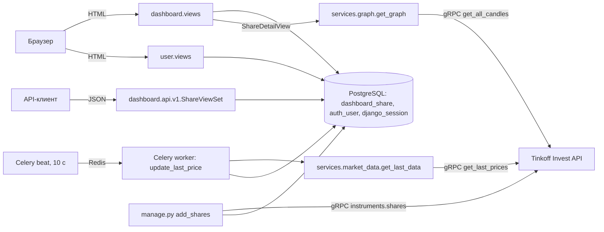

# ANALYSIS.md — Investing Demo

## 1. Анализ кода

Анализ выполнен только по исходному коду в репозитории, приложение не запускалось. Ссылки даны в формате `файл:строка` → функция или класс.

### 1.1. Назначение приложения и технологический стек

**Назначение.** Это веб-приложение, которое ведёт справочник акций и показывает по ним рыночные данные:

- список акций с текущей ценой и признаком роста или падения цены. Ячейка с ценой подсвечена зелёным или красным: `dashboard/templates/dashboard/list.html:35-40`, `dashboard/views.py:20` → `ShareListView`;
- карточка акции с графиком цен закрытия за последние 180 дней: `dashboard/views.py:29` → `ShareDetailView.get`, `dashboard/services/graph.py:11` → `get_graph`;
- создание, редактирование и удаление акций. Доступно только авторизованным пользователям: `dashboard/views.py:41-63` → `ShareCreateView`, `ShareUpdateView`, `ShareDeleteView`;
- REST API для CRUD-операций над акциями: `dashboard/api/v1/views.py:16` → `ShareViewSet`;
- регистрация, вход и выход пользователей: `user/views.py` → `AuthView`, `RegistrationView`, `LogoutView`;
- первичная загрузка справочника акций из Tinkoff Invest API: `dashboard/management/commands/add_shares.py:8` → `Command.handle`;
- периодическое обновление последней цены через Celery: `dashboard/tasks.py:7` → `update_last_price`, `config/celery.py:13` → `app.conf.beat_schedule`.

Источник рыночных данных — **Tinkoff Invest API** (gRPC SDK `tinkoff.invest`). Он используется в трёх местах:

- `dashboard/services/market_data.py` → `get_last_data`;
- `dashboard/services/graph.py` → `get_graph`;
- `dashboard/management/commands/add_shares.py` → `Command.handle`.

Токен хранится в `config/settings.py:134` → `TINKOFF_TOKEN` и там пустой.

**Технологический стек**

| Слой | Технология | Где видно |
|---|---|---|
| Язык | Python 3 | `manage.py`, все `*.py` |
| Веб-фреймворк | Django 4.1.7 | `requirements.txt:13`; комментарии в миграциях `dashboard/migrations/0001_add_share.py:1` |
| REST API | Django REST Framework 3.14 + django-filter 22.1 | `requirements.txt:15-16`; `config/settings.py:31` → `REST_FRAMEWORK` |
| СУБД | PostgreSQL (драйвер psycopg2-binary) | `config/settings.py:91` → `DATABASES`; `docker-compose.yml:3` → сервис `db` |
| Фоновые задачи | Celery 5.2.7 (worker + beat) | `config/celery.py`, `dashboard/tasks.py` |
| Брокер сообщений | Redis | `config/settings.py:141` → `CELERY_BROKER_URL`; `docker-compose.yml:16` → сервис `redis` |
| Рыночные данные | `tinkoff-investments==0.2.0b50` (gRPC, protobuf) | `requirements.txt:36`, `dashboard/services/*.py` |
| Графики | Plotly 5.13 (`plotly.offline.plot`, вывод HTML-`div`) | `dashboard/services/graph.py:21` |
| UI | Шаблоны Django, Bootstrap 5.1.3 (локальная статика), django-crispy-forms 2.0 с пакетом шаблонов `bootstrap3` | `dashboard/templates/**`, `dashboard/static/dashboard/css/bootstrap.min.css`, `config/settings.py:28-29` |
| Инфраструктура | Docker Compose (только PostgreSQL и Redis, контейнера с приложением нет) | `docker-compose.yml` |
| Тесты | DRF `APITestCase` | `dashboard/tests.py:8` → `DashboardTests` |

### 1.2. Структура проекта и основные компоненты

```
config/                Django-проект (настройки, корневой роутинг, Celery, WSGI/ASGI)
  settings.py          настройки: приложения, БД, DRF, логирование, Celery, TINKOFF_TOKEN
  urls.py              корневой URLconf
  celery.py            экземпляр Celery и расписание beat
  __init__.py          экспорт celery_app (загрузка Celery при старте Django)
  wsgi.py / asgi.py    точки входа WSGI/ASGI
dashboard/             основное приложение «акции»
  models.py            модель Share
  views.py             HTML-представления (CBV) и миксин доступа
  forms.py             ShareModelForm
  urls.py              маршруты HTML-части и подключение API
  admin.py             регистрация Share в админке
  tasks.py             Celery-задача update_last_price
  services/
    market_data.py     получение последней цены (Tinkoff)
    graph.py           построение графика свечей (Tinkoff + Plotly)
  api/                 REST API: версия v1 (router, serializer, views, urls)
  management/commands/add_shares.py   команда загрузки справочника акций
  migrations/0001..0007               история схемы таблицы Share
  templates/dashboard/  base, list, detail, create, delete
  static/dashboard/css/ bootstrap.min.css, sticky-footer-navbar.css
  tests.py             тесты REST API и главной страницы
user/                  приложение аутентификации
  models.py            алиас User = get_user_model() (своих моделей нет)
  forms.py             RegistrationForm, AuthForm
  views.py             AuthView, RegistrationView, LogoutView
  urls.py              login/, registration/, logout/
  templates/user/      base, auth, registration
  static/user/css/     bootstrap.min.css, signin.css
docker-compose.yml     PostgreSQL + Redis
requirements.txt       зафиксированные версии зависимостей
README.md              инструкции по запуску
```

**Компоненты и их назначение**

| Компонент | Файл → класс/функция | Назначение |
|---|---|---|
| Настройки | `config/settings.py` | `INSTALLED_APPS` (стр. 13), `DATABASES` (стр. 91), `REST_FRAMEWORK` (стр. 31), `LOGGING` + глобальный `logger` (стр. 37, 59), `TINKOFF_TOKEN` (стр. 134), `CELERY_*` (стр. 137-144) |
| Корневой роутинг | `config/urls.py:4` → `urlpatterns` | `admin/` → админка; `""` → `dashboard.urls`; `"user"` → `user.urls` |
| Celery-приложение | `config/celery.py:7` → `app` | конфигурация из настроек с префиксом `CELERY`, `autodiscover_tasks()`, расписание `beat_schedule` |
| Модель акции | `dashboard/models.py:4` → `Share` | единственная прикладная сущность |
| HTML CRUD | `dashboard/views.py` → `ShareListView`, `ShareDetailView`, `ShareCreateView`, `ShareUpdateView`, `ShareDeleteView` | веб-интерфейс |
| Контроль доступа | `dashboard/views.py:11` → `IsUserAuthenticatedMixin` | `test_func` проверяет `is_authenticated`, `handle_no_permission` перенаправляет на `dashboard:index` |
| Форма акции | `dashboard/forms.py:6` → `ShareModelForm` | `ModelForm` со всеми редактируемыми полями (`fields="__all__"`) |
| REST API | `dashboard/api/v1/views.py:16` → `ShareViewSet`; `serializer.py:6` → `ShareSerializer`; `router.py:5` → `DefaultRouter` | CRUD `/api/v1/shares/` с фильтрацией, поиском и сортировкой |
| Сервис цен | `dashboard/services/market_data.py:6` → `get_last_data` | последняя цена по FIGI |
| Сервис графика | `dashboard/services/graph.py:11` → `get_graph` | дневные свечи за 180 дней → Plotly `div` |
| Фоновое обновление | `dashboard/tasks.py:7` → `update_last_price` | обходит все акции и сохраняет `last_price` и `is_trend_high` |
| Импорт справочника | `dashboard/management/commands/add_shares.py:8` → `Command` | `python manage.py add_shares` |
| Админка | `dashboard/admin.py:6` → `ShareAdmin` | список, поиск и форма редактирования акций |
| Аутентификация | `user/views.py`, `user/forms.py` | вход, регистрация и выход на основе `django.contrib.auth` |

### 1.3. Архитектура и взаимодействие компонентов

Это монолитное Django-приложение по схеме MTV (Model–Template–View). Логика работы с внешним API вынесена в простой сервисный слой `dashboard/services`. Приложение работает в трёх процессах:

1. **Веб-процесс Django** (`config/wsgi.py` → `application`). Отдаёт HTML-страницы и REST API.
2. **Celery beat** (`config/celery.py:13` → `beat_schedule`). Каждые **10 секунд** ставит в очередь задачу `dashboard.tasks.update_last_price`. Ключ расписания называется `"add-every-5-min"`, но значение `schedule` равно `10.0` секундам.
3. **Celery worker**. Выполняет `update_last_price` (`dashboard/tasks.py:7`). Брокер — Redis (`config/settings.py:141`).

Есть и разовый процесс: management-команда `add_shares`.



**Ключевые взаимодействия**

- **Цена хранится в БД, график строится на лету.** Страница списка читает `last_price` и `is_trend_high` из БД (`list.html:35-40`), а эти поля пишет фоновая задача (`tasks.py:24` → `Share.objects.filter(id=...).update(...)`). Страница карточки при каждом запросе синхронно обращается к Tinkoff за свечами (`views.py:37` → `get_graph(share)`). Исторические цены в БД не сохраняются.
- **Как вычисляется тренд.** Функция `update_last_price` сравнивает ранее сохранённую `share.last_price` с новой ценой. Если старая цена больше новой, записывается `is_trend_high=False`, иначе `True`. Если старой цены нет, сравнение с `None` бросает исключение, оно логируется и `is_trend_high` становится `True` (`tasks.py:15-22`).
- **Что работает без доступа к Tinkoff Invest API** (например, при пустом `TINKOFF_TOKEN`):
  - **Список акций** (`ShareListView`), CRUD-формы, админка и REST API работают. Они читают и пишут только БД и к Tinkoff не обращаются. Колонка «Текущая цена» при этом остаётся пустой: `update_last_price` падает на каждой акции, исключение логируется (`tasks.py:27-28`), и `last_price` не заполняется.
  - **Страница акции** (`ShareDetailView.get`) не работает. Она безусловно вызывает `get_graph(share)` (`views.py:37`), а ошибка gRPC-клиента в `get_graph` (`graph.py:12-18`) нигде не перехватывается, поэтому пользователь получает HTTP 500.
  - **Команда `add_shares`** не работает, а без неё справочник акций изначально пуст.
- **Точность цены.** И `get_last_data` (`market_data.py:11` → `resp.price.units`), и `get_graph` (`graph.py:20` → `candle.close.units`) берут только целую часть `Quotation`. Дробная часть (`nano`) отбрасывается.
- **Поле `updated_at` не меняется при обновлении цены.** `QuerySet.update()` в `tasks.py:24` не вызывает `save()`, поэтому `auto_now` у `updated_at` (`models.py:17`) не срабатывает. Поле меняется только при сохранении через форму, админку или API.
- **Логирование.** Используется общий объект `logger` из `config/settings.py:59`. Его напрямую импортируют `dashboard/tasks.py:4` и `dashboard/services/market_data.py:3`. Логи пишутся в консоль и в файл `app.logs` (`settings.py:48-52`).
- **Загрузка Celery вместе с Django.** Файл `config/__init__.py:1` импортирует `celery_app`, поэтому `@app.task` регистрируется при загрузке Django.

**Маршрутизация (итоговые URL)**

| URL | Обработчик | Имя маршрута |
|---|---|---|
| `/` | `dashboard.views.ShareListView` | `dashboard:index` |
| `/<pk>` | `dashboard.views.ShareDetailView` | `dashboard:detail` |
| `/create` | `dashboard.views.ShareCreateView` | `dashboard:create` |
| `/update/<pk>` | `dashboard.views.ShareUpdateView` | `dashboard:update` |
| `/delete/<pk>` | `dashboard.views.ShareDeleteView` | `dashboard:delete` |
| `/api/v1/` | корень `DefaultRouter` | `api-root` |
| `/api/v1/shares/`, `/api/v1/shares/<pk>/` | `dashboard.api.v1.views.ShareViewSet` | `share-list`, `share-detail` |
| `/userlogin/` | `user.views.AuthView` | `user:auth` |
| `/userregistration/` | `user.views.RegistrationView` | `user:registration` |
| `/userlogout/` | `user.views.LogoutView` | `user:logout` |
| `/admin/` | `django.contrib.admin` | — |

Маршрут `/api/` подключён внутри `dashboard/urls.py:19`, а не в корневом URLconf. Маршруты пользователя склеиваются без слэша, получается `/userlogin/`, потому что в `config/urls.py:7` указан префикс `path("user", ...)` без завершающего `/`.

### 1.4. Библиотеки и внешние зависимости

**Python-пакеты** (`requirements.txt`). Напрямую в коде используются:

| Пакет | Версия | Где используется |
|---|---|---|
| Django | 4.1.7 | весь проект |
| djangorestframework | 3.14.0 | `dashboard/api/v1/*`, `dashboard/tests.py` |
| django-filter | 22.1 | `dashboard/api/v1/views.py:1` → `ShareFilter`, `DjangoFilterBackend` |
| django-crispy-forms | 2.0 | `config/settings.py:20`; `dashboard/templates/dashboard/create.html:8` → `as_crispy_field` |
| crispy-bootstrap3 | 2022.1 | `config/settings.py:21, 28-29` (пакет шаблонов форм) |
| celery | 5.2.7 | `config/celery.py`, `dashboard/tasks.py` |
| redis | 4.5.1 | транспорт брокера Celery (`CELERY_BROKER_URL`) |
| psycopg2-binary | 2.9.5 | драйвер `django.db.backends.postgresql` |
| plotly | 5.13.1 | `dashboard/services/graph.py:3-4` |
| tinkoff-investments | 0.2.0b50 | `tinkoff.invest.Client`, `CandleInterval`, `utils.now` в `services/*.py` и `add_shares.py` |
| grpcio, protobuf | 1.51.3, 3.20.3 | транзитивные зависимости `tinkoff-investments` |

Остальное — транзитивные зависимости: `amqp`, `kombu`, `billiard`, `vine`, `click*` от Celery; `asgiref`, `sqlparse` от Django; `pydantic`, `cachetools`, `python-dateutil` и другие. Кроме того, в файл попали инструменты разработчика `black`, `isort`, `mypy-extensions`, `pathspec`, `platformdirs`, `tomli` и пакет `tinkoff==0.1.1`, который в коде не импортируется. Пакет `eventlet` упомянут в `README.md:19` для запуска worker под Windows, но в `requirements.txt` его нет.

**Внешние сервисы и инфраструктура**

- PostgreSQL: `docker-compose.yml:3` → `db`, образ `postgres` без фиксированной версии, БД `investing`, пользователь и пароль `postgres/postgres`, порт 5432. Тома для данных нет; вместо него каталог проекта смонтирован в `/app` контейнера БД (`docker-compose.yml:13-14`).
- Redis: `docker-compose.yml:16` → `redis`, образ `redis`, порт 6379.
- Tinkoff Invest API: сетевой gRPC-доступ по токену `TINKOFF_TOKEN`.

**Внешние фронтенд-ресурсы (CDN)**, `dashboard/templates/dashboard/base.html:10-24`:

- `plotly-latest.min.js`;
- jQuery 3.3.1 slim;
- Popper 1.14.6;
- Font Awesome 4.7.0;
- Moment.js 2.23.0;
- Tempus Dominus Bootstrap 4 5.1.2.

Bootstrap 5.1.3 лежит локально в двух копиях: `dashboard/static/dashboard/css/bootstrap.min.css` и `user/static/user/css/bootstrap.min.css`.

### 1.5. Модель данных

**Сущность `Share` (акция).** Таблица `dashboard_share`, класс `dashboard/models.py:4`. В `Meta` заданы `verbose_name="Акция"` и `verbose_name_plural="Акции"`.

| Атрибут | Тип | Ограничения | Назначение |
|---|---|---|---|
| `id` | `BigAutoField` | PK (`dashboard/apps.py:5`, `settings.py:132`) | суррогатный ключ |
| `figi` | `CharField(255)` | `unique=True` | идентификатор инструмента FIGI, по нему идут запросы к Tinkoff |
| `isin` | `CharField(255)` | обязательное | международный код ISIN |
| `name` | `CharField(255)` | обязательное | «Наименование компании» |
| `ticker` | `CharField(10)` | `unique=True` | «Тикер» |
| `currency` | `CharField(20)` | обязательное | «Валюта» |
| `uid` | `CharField(255)` | `unique=True`, обязательное | внутренний UID инструмента в Tinkoff |
| `last_price` | `FloatField` | `null=True, blank=True` | «Текущая цена» |
| `is_trend_high` | `BooleanField` | `null=True, blank=True` | «Растет цена»: направление последнего изменения |
| `updated_at` | `DateTimeField(auto_now=True)` | `null=True, blank=True` | время последнего сохранения через `save()` |

Схема складывалась миграциями:

- `0001_add_share`: базовые поля;
- `0002_update_share`: уникальность `figi` и `ticker`;
- `0003_add_uuid`: поле `uid`;
- `0004_add_last_price`: поля `last_price` и `is_trend_high`;
- `0005`, `0006`: только `verbose_name`;
- `0007_add_updated_at`: поле `updated_at`.

**Пользователь.** Своей модели нет. `user/models.py:3` → `User = get_user_model()`, то есть используется стандартная `django.contrib.auth.models.User` (таблица `auth_user`). При регистрации email записывается и в `username`, и в `email`: `user/forms.py:51` → `User.objects.create_user(email, email, password)`.

**Связи.** Между `Share` и `User` связей нет: ни одного `ForeignKey`, `ManyToMany` или `OneToOne` в проекте. Пользователи не владеют акциями, все акции общие. Прочие таблицы стандартные для подключённых `django.contrib.*`: сессии, права, `contenttypes`, журнал админки.

### 1.6. Обработка пользовательских запросов и взаимодействие с БД

**Общий конвейер.** Запрос проходит стандартный список `MIDDLEWARE` (`config/settings.py:61`): Security, Session, Common, CSRF, Authentication, Messages, XFrame. Затем он попадает в URLconf (`config/urls.py`) и в CBV или ViewSet. Доступ к БД идёт только через Django ORM; «сырого» SQL в проекте нет.

**HTML-часть (`dashboard/views.py`)**

| Представление | Запрос | Работа с БД и логика |
|---|---|---|
| `ShareListView` (`ListView`) | GET `/` | `Share.objects.order_by("name")` (`ordering`), пагинация по 100 записей (`paginate_by`), шаблон `list.html`. Кнопки управления видны только при `user.is_authenticated` |
| `ShareDetailView.get` | GET `/<pk>` | `Share.objects.get(id=pk)` (`views.py:32`). Если записи нет, `DoesNotExist` не перехватывается, и ответ будет 500, а не 404. Затем вызывается `get_graph(share)` с запросом к Tinkoff. HTML графика выводится через `` (`detail.html:23`) |
| `ShareCreateView` (`CreateView`) | GET/POST `/create` | Проверка `IsUserAuthenticatedMixin`. При POST `ShareModelForm` проверяет данные (обязательность, уникальность `figi`/`ticker`/`uid`) и выполняет `form.save()`, то есть INSERT. Затем редирект на `dashboard:index` |
| `ShareUpdateView` (`UpdateView`) | GET/POST `/update/<pk>` | `get_object()` по `pk` (404, если записи нет), валидация формы, `save()` (UPDATE, обновляет `updated_at`) |
| `ShareDeleteView` (`DeleteView`) | GET/POST `/delete/<pk>` | GET показывает подтверждение (`delete.html`), POST выполняет DELETE |

Неавторизованный пользователь на защищённых страницах не получает 403: `IsUserAuthenticatedMixin.handle_no_permission` (`views.py:15-17`) молча перенаправляет его на главную.

**REST API (`dashboard/api/v1/views.py:16` → `ShareViewSet`, `ModelViewSet`)**

- Методы: `list`, `retrieve`, `create`, `update`, `partial_update`, `destroy` на `/api/v1/shares/` и `/api/v1/shares/<pk>/`. Набор записей — `Share.objects.all()`.
- Сериализация: `ShareSerializer` (`serializer.py:6`) отдаёт поля `id, figi, isin, name, ticker, currency, last_price, is_trend_high, updated_at`. Поля `uid` в нём нет. При создании через API оно получает значение по умолчанию `""`, поэтому вторая запись, созданная через API, нарушит `unique` у `uid`.
- Фильтрация, поиск, сортировка: `ShareFilter` (`views.py:10`) фильтрует по точному совпадению `name` и `ticker` (`?name=`, `?ticker=`); `OrderingFilter` сортирует по `name` и `ticker` (`?ordering=`); `SearchFilter` с `search_fields=["$name"]` ищет по регулярному выражению в `name` (`?search=`).
- Пагинация: `LimitOffsetPagination` с `PAGE_SIZE=100` (`config/settings.py:32-33`). Ответ имеет вид `{count, next, previous, results}`.
- Права доступа: `permission_classes` не заданы, и в `REST_FRAMEWORK` нет `DEFAULT_PERMISSION_CLASSES`. Значит, действует `AllowAny`: анонимный клиент может создавать, изменять и удалять акции через API, хотя в HTML-части те же операции закрыты `IsUserAuthenticatedMixin`.
- Это поведение (CRUD, 201, 204, 400, 404) проверяется тестами `dashboard/tests.py` → `DashboardTests.test_share_*`.

**Аутентификация (`user/views.py`, `user/forms.py`)**

- `AuthView.post`: форма `AuthForm` не проверяется (`is_valid()` не вызывается). Значения берутся из `form.data`, email приводится к нижнему регистру, затем вызываются `authenticate(...)` и `login(...)`. Последний — запись в `django_session`. После этого редирект на `dashboard:index` или повторный показ формы с ошибкой.
- `RegistrationView.post`: `RegistrationForm.is_valid()` → `clean()` проверяет совпадение паролей и уникальность email (`User.objects.filter(email=email)`). Затем `save()` вызывает `create_user` (INSERT в `auth_user`) и `authenticate`, после чего выполняется `login` и редирект. Особенности:
  - email при регистрации не приводится к нижнему регистру, а при входе приводится (`AuthView.post`);
  - `AUTH_PASSWORD_VALIDATORS` в форме не применяются;
  - при ошибке только в отдельном поле, без общей ошибки формы, `form.errors["__all__"]` (`user/views.py:54`) и `self.cleaned_data["email"]` (`user/forms.py:32`) могут бросить `KeyError`.
- `LogoutView.get`: выполняет `logout(request)` (удаляет сессию) и редирект.

**Фоновые и пакетные операции с БД**

- `update_last_price` (`dashboard/tasks.py:7`): один SELECT `Share.objects.all()`, затем для каждой акции отдельный gRPC-запрос и отдельный `UPDATE ... WHERE id=` (`tasks.py:24`). Получается N+1 запросов к API и N UPDATE за запуск, раз в 10 секунд. Ошибки по каждой акции логируются и не прерывают цикл.
- `add_shares` (`add_shares.py:15`): для каждого инструмента из `client.instruments.shares()` вызывается `Share.objects.get_or_create(...)` по всем шести полям сразу. Если любой атрибут инструмента изменился, `get_or_create` попробует вставить новую строку и упадёт на `unique` по `figi`, `ticker` или `uid`. Транзакции и обработки ошибок нет.

**Конфигурационные моменты, влияющие на запуск**

- `SECRET_KEY = ""` (`config/settings.py:6`): Django не стартует с пустым ключом.
- `TINKOFF_TOKEN = ""` (`settings.py:134`): все обращения к Tinkoff будут отклонены. При этом по условиям задания токен Т-Инвестиций недоступен, и источником данных должно стать публичное API Мосбиржи ISS.
- Параметры БД (`settings.py:96-103`) и брокера (`settings.py:141`) жёстко прописаны в коде, переменные окружения не используются.
- `DEBUG = True` и пустой `ALLOWED_HOSTS` (`settings.py:8-10`).

## 2. Функциональные требования

Требования восстановлены по исходному коду и описывают **фактически реализованное** поведение, а не желаемое. Выявленные дефекты и противоречия вынесены в раздел 2.5 и требованиями не считаются. Ссылки даны в формате `файл:строка → класс/функция`.

### 2.1. Основные функциональные возможности

1. Просмотр списка акций с текущей ценой и индикатором направления её изменения. Доступен всем.
2. Просмотр карточки акции с графиком дневных цен закрытия за 180 дней. Доступен всем.
3. Добавление, редактирование и удаление акций через веб-интерфейс. Только для авторизованных пользователей.
4. REST API `/api/v1/shares/`: CRUD с фильтрацией, поиском, сортировкой и пагинацией.
5. Регистрация, вход и выход пользователей по email и паролю.
6. Администрирование справочника акций через Django Admin.
7. Первичная загрузка справочника акций из Tinkoff Invest API (management-команда).
8. Периодическое автоматическое обновление последней цены и признака тренда (Celery).

### 2.2. Сценарии взаимодействия пользователя

**UC-1. Анонимный посетитель просматривает акции.**
1. Посетитель открывает `/` и видит таблицу акций, отсортированную по названию, по 100 акций на странице.
2. Посетитель переходит по тикеру на страницу `/<id>`.
3. Система показывает название, цену, время обновления и график.

В шапке видна кнопка «Войти». Кнопок «Добавить», «Редактировать» и «Удалить» нет. Код: `dashboard/views.py` → `ShareListView`, `ShareDetailView`; `dashboard/templates/dashboard/list.html`, `base.html`.

**UC-2. Регистрация.**
1. Посетитель нажимает «Войти», затем «Зарегистрироваться» и попадает на `/userregistration/`.
2. Вводит email и дважды пароль.
3. Если данные корректны, система создаёт пользователя, сразу авторизует его и перенаправляет на главную. Иначе снова показывает форму с текстом ошибки.

Код: `user/views.py` → `RegistrationView`.

**UC-3. Вход и выход.**
1. Пользователь вводит email и пароль на `/userlogin/`.
2. При успехе система перенаправляет его на главную, где в шапке отображается «Привет, <email>» и кнопка «Выход».
3. «Выход» (`/userlogout/`) завершает сессию и возвращает на главную.

Код: `user/views.py` → `AuthView`, `LogoutView`.

**UC-4. Авторизованный пользователь управляет акциями.**
- «Добавить» открывает `/create`: форма со всеми полями акции, кнопка «Сохранить», после сохранения возврат к списку.
- «Редактировать» открывает `/update/<id>`: та же форма, заполненная текущими значениями.
- «Удалить» открывает `/delete/<id>`: страница подтверждения, после подтверждения возврат к списку.

Код: `dashboard/views.py` → `ShareCreateView`, `ShareUpdateView`, `ShareDeleteView`.

**UC-5. Внешний клиент работает через REST API.** Клиент выполняет `GET`, `POST`, `PUT`, `PATCH` и `DELETE` на `/api/v1/shares/` и `/api/v1/shares/<id>/` и получает JSON. Код: `dashboard/api/v1/views.py` → `ShareViewSet`.

**UC-6. Администратор/оператор.**
1. Выполняет `python manage.py add_shares`, чтобы загрузить справочник.
2. Запускает Celery beat и worker, чтобы цены обновлялись.
3. Редактирует акции в `/admin/`.

Код: `dashboard/management/commands/add_shares.py`, `config/celery.py`, `dashboard/admin.py`.

### 2.3. Бизнес-правила, проверки и ограничения

| № | Правило | Где в коде |
|---|---|---|
| BR-1 | FIGI акции уникален, до 255 символов, обязателен | `dashboard/models.py:7` → `Share.figi` |
| BR-2 | Тикер уникален, до 10 символов, обязателен | `dashboard/models.py:10` → `Share.ticker` |
| BR-3 | UID акции уникален, до 255 символов, обязателен в форме и админке | `dashboard/models.py:12` → `Share.uid` |
| BR-4 | ISIN (до 255) и наименование (до 255) обязательны; валюта обязательна, до 20 символов | `dashboard/models.py:8-11` |
| BR-5 | Цена (`last_price`) и признак роста (`is_trend_high`) необязательны и могут быть пустыми | `dashboard/models.py:13-16` |
| BR-6 | `updated_at` выставляется автоматически при каждом сохранении записи через `save()` и вручную не редактируется | `dashboard/models.py:17` (`auto_now=True`) |
| BR-7 | Признак тренда: если новая цена меньше сохранённой, тренд «падает» (`False`); если больше **или равна**, тренд «растёт» (`True`); если сохранённой цены нет, тренд «растёт» (`True`) | `dashboard/tasks.py:15-22` → `update_last_price` |
| BR-8 | Создавать, редактировать и удалять акции через веб-интерфейс может только аутентифицированный пользователь; иначе выполняется перенаправление на главную | `dashboard/views.py:11-17` → `IsUserAuthenticatedMixin` |
| BR-9 | Для регистрации пароль и его подтверждение должны совпадать | `user/forms.py:35-37` → `RegistrationForm.clean` |
| BR-10 | Email при регистрации должен быть уникальным среди пользователей | `user/forms.py:39-46` → `RegistrationForm.clean` |
| BR-11 | Email используется как логин: он сохраняется и в `username`, и в `email` | `user/forms.py:51` → `RegistrationForm.save` |
| BR-12 | При входе email приводится к нижнему регистру | `user/views.py:19` → `AuthView.post` |
| BR-13 | Список акций в вебе: сортировка по названию, 100 записей на страницу | `dashboard/views.py:25-26` → `ShareListView` |
| BR-14 | Список в API: `limit/offset`, по умолчанию 100 записей | `config/settings.py:31-35` → `REST_FRAMEWORK` |
| BR-15 | График строится по дневным свечам за последние 180 дней, по целой части цены закрытия | `dashboard/services/graph.py:14-20` → `get_graph` |
| BR-16 | Цена обновляется по расписанию каждые 10 секунд | `config/celery.py:13-18` → `beat_schedule` |
| BR-17 | Ошибка получения цены по одной акции не прерывает обновление остальных: она логируется | `dashboard/tasks.py:27-28` → `update_last_price` |
| BR-18 | Все изменяющие операции веб-интерфейса защищены CSRF-токеном | `config/settings.py:65` (`CsrfViewMiddleware`); `` в `create.html`, `delete.html`, `auth.html`, `registration.html` |

### 2.4. Функциональные требования

**Список и просмотр акций**

- **FR-1.** По адресу `/` система отображает всем пользователям, включая анонимных, таблицу акций из БД с колонками «Тикер», «Название», «ISIN», «Текущая цена». Код: `dashboard/views.py:20` → `ShareListView`; `dashboard/templates/dashboard/list.html:16-58`.
- **FR-2.** Список акций сортируется по полю «Наименование» по возрастанию. Код: `dashboard/views.py:26` → `ShareListView.ordering`.
- **FR-3.** Список разбит на страницы по 100 акций. Под таблицей есть навигация: ««», номера страниц с выделением текущей, «»». Переход выполняется параметром `?page=N`. Код: `dashboard/views.py:25` → `ShareListView.paginate_by`; `list.html:60-80`.
- **FR-4.** Ячейка «Текущая цена» показывает значение `last_price` и валюту. Если `is_trend_high` истинно, фон ячейки зелёный (`mediumseagreen`), иначе красный (`palevioletred`). Код: `list.html:35-40`.
- **FR-5.** Если в БД нет акций, вместо таблицы выводится текст «Акций еще нет». Код: `list.html:83-85`.
- **FR-6.** Тикер в списке является ссылкой на страницу акции `/<id>`. Код: `list.html:32`; `dashboard/urls.py:15` → `dashboard:detail`.
- **FR-7.** Страница акции `/<id>` доступна всем. Она показывает наименование, текущую цену с валютой и время последнего сохранения записи (`updated_at`). Код: `dashboard/views.py:29-38` → `ShareDetailView.get`; `detail.html:11-13`.
- **FR-8.** На странице акции выводится раздел «Исторические данные» с линейным графиком Plotly. По оси X идут даты, по оси Y — цена закрытия (целая часть) дневных свечей Tinkoff Invest API за последние 180 дней по FIGI акции. Данные запрашиваются при каждом открытии страницы. Код: `dashboard/services/graph.py:11` → `get_graph`; `detail.html:22-25`.

**Управление акциями (веб)**

- **FR-9.** Кнопка «Добавить» над списком и колонка «Управление» с кнопками «Редактировать» и «Удалить» отображаются только аутентифицированному пользователю. Код: `list.html:9-13, 23-25, 41-50`.
- **FR-10.** Аутентифицированный пользователь может добавить акцию на странице `/create`. В форме есть поля FIGI, ISIN, «Наименование компании», «Тикер», «Валюта», UID, «Текущая цена», «Растет цена». После успешного сохранения выполняется переход на главную. Код: `dashboard/views.py:41-46` → `ShareCreateView`; `dashboard/forms.py:6` → `ShareModelForm`; `create.html`.
- **FR-11.** При сохранении формы акции система проверяет обязательность полей, их максимальную длину и уникальность FIGI, тикера и UID (BR-1…BR-5). При ошибке форма показывается повторно с сообщениями у полей. Код: `dashboard/forms.py:6` → `ShareModelForm`; `dashboard/models.py:4` → `Share`.
- **FR-12.** Аутентифицированный пользователь может отредактировать акцию на странице `/update/<id>`. Форма та же, что при создании, и заполнена текущими значениями. Если акции нет, возвращается 404. После сохранения выполняется переход на главную, `updated_at` обновляется. Код: `dashboard/views.py:49-55` → `ShareUpdateView`.
- **FR-13.** Аутентифицированный пользователь может удалить акцию. GET `/delete/<id>` показывает вопрос «Вы уверены, что хотите удалить инструмент: "<название>"?» и кнопку «Удалить». POST удаляет запись и выполняет переход на главную. Если акции нет, возвращается 404. Код: `dashboard/views.py:58-63` → `ShareDeleteView`; `delete.html`.
- **FR-14.** Неаутентифицированный пользователь при обращении к `/create`, `/update/<id>` или `/delete/<id>` любым методом перенаправляется на главную `/` без сообщения об ошибке. Код: `dashboard/views.py:11-17` → `IsUserAuthenticatedMixin.test_func`, `handle_no_permission`.

**REST API**

- **FR-15.** `GET /api/v1/shares/` возвращает список акций в формате `{count, next, previous, results}` с пагинацией `limit/offset`, по умолчанию 100 записей. Каждый элемент содержит `id, figi, isin, name, ticker, currency, last_price, is_trend_high, updated_at`. Код: `dashboard/api/v1/views.py:16` → `ShareViewSet`; `serializer.py:6` → `ShareSerializer`; `config/settings.py:32-33`.
- **FR-16.** Список в API поддерживает:
  - фильтрацию по точному значению `?name=` и `?ticker=` (`dashboard/api/v1/views.py:10` → `ShareFilter`);
  - поиск по названию регулярным выражением `?search=` (`search_fields=["$name"]`);
  - сортировку `?ordering=name|ticker|-name|-ticker` (`ordering_fields`).
- **FR-17.** `GET /api/v1/shares/<id>/` возвращает одну акцию или 404, если её нет. Код: `ShareViewSet` (retrieve); тесты `dashboard/tests.py` → `test_share_detail`, `test_share_detail_invalid`.
- **FR-18.** `POST /api/v1/shares/` создаёт акцию и возвращает 201 с созданным объектом. Поля `figi, isin, name, ticker, currency` обязательны, `last_price` и `is_trend_high` необязательны. Если не хватает обязательных полей или нарушена уникальность `figi`/`ticker`, возвращается 400. Код: `ShareViewSet` (create), `ShareSerializer`; тесты `test_share_create`, `test_share_create_invalid`.
- **FR-19.** `PUT /api/v1/shares/<id>/` полностью обновляет акцию и возвращает 200, при неполных данных — 400. `PATCH` обновляет акцию частично. Код: `ShareViewSet` (update/partial_update); тесты `test_share_update`, `test_share_update_invalid`.
- **FR-20.** `DELETE /api/v1/shares/<id>/` удаляет акцию и возвращает 204, а если акции нет — 404. Код: `ShareViewSet` (destroy); тесты `test_share_delete`, `test_share_delete_invalid`.
- **FR-21.** Поля `id` и `updated_at` в API доступны только для чтения. Код: `ShareSerializer` (`id` — первичный ключ, `updated_at` — `auto_now`, оба DRF делает read-only).
- **FR-22.** Операции API не требуют аутентификации, потому что права доступа не настроены (`AllowAny` DRF по умолчанию). Код: `dashboard/api/v1/views.py:16` → `ShareViewSet`; `config/settings.py:31-35`. Противоречие с FR-14 описано в D-6.
- **FR-23.** `GET /api/v1/` возвращает корневую страницу API (browsable API) со ссылкой на ресурс `shares`. Код: `dashboard/api/v1/router.py:5` → `routers.DefaultRouter`.

**Пользователи**

- **FR-24.** Страница регистрации `/userregistration/` содержит поля «Email», «Пароль», «Повторите пароль» и ссылку «Войти». Код: `user/views.py:36-41` → `RegistrationView.get`; `user/forms.py:8` → `RegistrationForm`; `registration.html`.
- **FR-25.** При регистрации система проверяет:
  - email корректен;
  - все поля заполнены;
  - пароли совпадают, иначе ошибка «Введенные пароли не совпадают»;
  - email ещё не зарегистрирован, иначе ошибка «Данный e-mail уже зарегистрирован! …».

  Ошибка выводится под полями формы. Код: `user/forms.py:30-46` → `RegistrationForm.clean`; `user/views.py:50-55` → `RegistrationView.post`.
- **FR-26.** После успешной регистрации система создаёт пользователя с `username=email` и `email=email`, автоматически выполняет вход и перенаправляет на главную. Код: `user/forms.py:48-53` → `RegistrationForm.save`; `user/views.py:46-49` → `RegistrationView.post`.
- **FR-27.** Страница входа `/userlogin/` содержит поля «Email», «Пароль» и ссылку «Зарегистрироваться». Система ищет пользователя по `username`, равному email в нижнем регистре, и проверяет пароль. При успехе создаётся сессия и выполняется переход на главную, иначе выводится «Неверный логин или пароль! Повторите попытку.». Код: `user/views.py:8-33` → `AuthView.get`, `AuthView.post`.
- **FR-28.** `GET /userlogout/` завершает сессию пользователя и перенаправляет на главную. Код: `user/views.py:58-64` → `LogoutView.get`.
- **FR-29.** В шапке всех страниц `dashboard` для аутентифицированного пользователя выводится «Привет, <email>» и кнопка «Выход», для анонимного — кнопка «Войти». Шапка и подвал содержат ссылку «Главная». Код: `dashboard/templates/dashboard/base.html:30-66`.

**Администрирование**

- **FR-30.** В Django Admin (`/admin/`) доступен раздел «Акции». Список показывает колонки FIGI, ISIN, наименование, тикер и валюту, а поиск идёт по FIGI, ISIN, наименованию и тикеру. Форма редактирования содержит поля `figi, isin, name, ticker, currency, uid, last_price, is_trend_high`. Код: `dashboard/admin.py:6-19` → `ShareAdmin`.

**Интеграция с рыночными данными и фоновые процессы**

- **FR-31.** Команда `python manage.py add_shares` запрашивает в Tinkoff Invest API список всех акций (`instruments.shares()`). Для каждой акции она создаёт запись `Share` с полями `figi, name, isin, ticker, currency, uid`, если такой записи с точно такими же значениями ещё нет. Код: `dashboard/management/commands/add_shares.py:11-22` → `Command.handle`.
- **FR-32.** Celery beat каждые 10 секунд ставит в очередь задачу `dashboard.tasks.update_last_price`. Код: `config/celery.py:13-18` → `beat_schedule`.
- **FR-33.** Задача `update_last_price` для каждой акции в БД:
  1. получает последнюю цену по FIGI из Tinkoff Invest API (целую часть цены);
  2. вычисляет признак тренда по правилу BR-7;
  3. сохраняет в записи `last_price` и `is_trend_high`.

  Код: `dashboard/tasks.py:7-28` → `update_last_price`; `dashboard/services/market_data.py:6` → `get_last_data`.
- **FR-34.** Если при обработке акции в `update_last_price` возникает ошибка, она пишется в лог, а задача переходит к следующей акции. Каждое успешное получение цены логируется сообщением «Get last data for share with id <id>». Код: `dashboard/tasks.py:27-28`; `dashboard/services/market_data.py:10`.
- **FR-35.** Логи приложения (логгер `main`) пишутся в консоль и в файл `app.logs` в формате `[module asctime level] message`. Код: `config/settings.py:37-59` → `LOGGING`, `logger`.

### 2.5. Неоднозначности, противоречия и возможные дефекты реализации

Эти пункты **не являются требованиями**. Это расхождения между вероятным замыслом и фактическим поведением, которые нужно учесть в задании 3.

**Конфигурация и запуск**

- **D-1. Приложение не стартует.** `SECRET_KEY = ""`, а Django при пустом ключе выбрасывает `ImproperlyConfigured`. Код: `config/settings.py:6`.
- **D-2. Токен Tinkoff пуст и зашит в код.** `TINKOFF_TOKEN = ""`, переменные окружения не используются. Без токена не работают FR-8, FR-31, FR-33. По условиям задания токена нет и не будет, так что эти функции нужно перевести на ISS Мосбиржи. Код: `config/settings.py:134`; `dashboard/services/*.py`; `add_shares.py`.
- **D-3. Секреты и параметры инфраструктуры в коде.** Пароль БД, хост и брокер жёстко прописаны, `DEBUG = True`, `ALLOWED_HOSTS = []`. Код: `config/settings.py:8-10, 96-103, 141`.
- **D-4. `docker-compose.yml`.**
  - Образы `postgres` и `redis` без версии.
  - Каталог проекта монтируется в контейнер БД (`./:/app`), что бессмысленно, а именованного тома для данных нет: после `docker compose down` данные теряются.
  - Сервиса приложения нет.
  - `README.md:4` использует устаревший `docker-compose`.

  Код: `docker-compose.yml:3-19`.
- **D-5. Зависимости устарели и частично лишние.** Django 4.1.7 больше не поддерживается. `tinkoff-investments==0.2.0b50` — бета-версия. `tinkoff==0.1.1` не используется. В рабочих зависимостях лежат инструменты разработчика `black` и `isort`. `psycopg2-binary==2.9.5`, `pydantic==1.10.6` и другие закреплённые версии, вероятно, не соберутся или не установятся на Python 3.13. Код: `requirements.txt`.

**Противоречия в правилах доступа**

- **D-6. Веб и API защищены по-разному.** В вебе изменять акции может только аутентифицированный пользователь (FR-14), а через REST API любой анонимный клиент может создавать, изменять и удалять акции (FR-22). Код: `dashboard/views.py:11` → `IsUserAuthenticatedMixin` против `dashboard/api/v1/views.py:16` → `ShareViewSet` без `permission_classes`. Анонимный доступ на запись закреплён тестами: `dashboard/tests.py` → `DashboardTests` выполняет `POST`, `PUT` и `DELETE` без входа в систему и ожидает 201, 200 и 204 (`test_share_create`, `test_share_update`, `test_share_delete`). Если закрыть API правами доступа, эти тесты нужно будет изменить вместе с исправлением.
- **D-7. Нет ролей и владельцев.** Любой зарегистрированный пользователь может удалить любую акцию. Неясно, задумано ли это. Код: `dashboard/views.py:58` → `ShareDeleteView`.
- **D-8. Отказ в доступе молчаливый.** Пользователя без прав перенаправляют на главную, а не на страницу входа (`?next=`), и без сообщения. Код: `dashboard/views.py:15-17` → `handle_no_permission`.
- **D-9. Выход по GET.** Он не защищён CSRF, поэтому выйти можно, просто открыв ссылку, например со стороннего сайта. Код: `user/views.py:58-64` → `LogoutView.get`.

**Дефекты страниц акций**

- **D-10. 500 вместо 404.** Для несуществующей акции `/<id>` `Share.objects.get` выбрасывает `DoesNotExist`, а это 500. Любая ошибка Tinkoff API (нет токена, сеть, лимиты) тоже даёт 500 на странице акции, потому что `get_graph` вызывается без обработки ошибок. Код: `dashboard/views.py:32, 37` → `ShareDetailView.get`.
- **D-11. Цена искажается.** Используется только целая часть `Quotation.units`, а дробная `nano` отбрасывается: цена 0,0123 ₽ хранится и показывается как 0, а 245,90 — как 245. Код: `dashboard/services/market_data.py:11` → `get_last_data`; `dashboard/services/graph.py:20` → `get_graph`.
- **D-12. «Время последнего обновления» не соответствует обновлению цены.** Задача `update_last_price` использует `QuerySet.update()`, при котором `auto_now` не срабатывает. Поэтому `updated_at` показывает время ручного редактирования, а не получения цены, хотя на странице акции это поле подписано «Время последнего обновления». Код: `dashboard/tasks.py:24`; `dashboard/models.py:17`; `detail.html:13`.
- **D-13. Неоднозначная семантика тренда.**
  - Равная цена считается ростом.
  - Первая цена тоже считается ростом, причём через перехват исключения `TypeError` при сравнении с `None`, а не явной проверкой.
  - Пока цены нет (`is_trend_high = None`), ячейка в списке окрашена красным, как при падении.

  Код: `dashboard/tasks.py:15-22`; `list.html:35-39`.
- **D-14. Цена и тренд правятся вручную, но перезаписываются.** Форма создания и редактирования (`fields="__all__"`) и админка позволяют задать `last_price` и `is_trend_high` вручную, но фоновая задача их перезаписывает. Код: `dashboard/forms.py:11`; `dashboard/admin.py:17-18`.
- **D-15. Конфликт версий Plotly.** В `base.html` подключён `plotly-latest.min.js` с CDN, а это замороженная версия 1.x. При этом `plot(..., output_type="div")` по умолчанию встраивает свою копию plotly.js 5.x прямо в страницу. Библиотека грузится дважды разных версий, а HTML-размер страницы увеличивается на несколько МБ. Серия на графике называется `"test"`. Код: `base.html:10`; `dashboard/services/graph.py:21-35`.
- **D-16. Лишние и несовместимые фронтенд-ресурсы.**
  - Локально лежит Bootstrap 5.1.3, а crispy-forms настроены на шаблоны `bootstrap3`, поэтому разметка форм не соответствует CSS.
  - С CDN подключены jQuery, Popper 1.x, Moment.js и Tempus Dominus для Bootstrap 4, которые нигде не используются.
  - Две копии `bootstrap.min.css` лежат в `dashboard` и в `user`.

  Код: `config/settings.py:28-29`; `base.html:10-24`.

**Дефекты REST API**

- **D-17. Создать через API можно только одну акцию.** Поля `uid` нет в `ShareSerializer.Meta.fields`, но в модели оно обязательное и уникальное. При `POST` в БД записывается `uid = ""`, поэтому вторая акция, созданная через API, вызовет `IntegrityError` и 500. Код: `dashboard/api/v1/serializer.py:9-19`; `dashboard/models.py:12`.
- **D-18. Неудобный поиск и фильтрация.** Поиск `$name` работает по регулярному выражению: некорректное выражение (например `?search=(`) может привести к ошибке БД, а поиск чувствителен к регистру. Фильтры `name` и `ticker` требуют точного совпадения. Код: `dashboard/api/v1/views.py:10-22`.

**Дефекты регистрации и входа**

- **D-19. Нельзя войти, если в email были заглавные буквы.** При регистрации email не приводится к нижнему регистру: `username` хранится как введено, а `normalize_email` понижает только домен. При входе email приводится к нижнему регистру. Пользователь, зарегистрированный как `Ivan@Mail.ru`, войти не сможет. Проверка уникальности (`filter(email=email)`) тоже регистрозависима, так что можно зарегистрировать `a@x.ru` и `A@x.ru`. Код: `user/forms.py:39, 51`; `user/views.py:19`.
- **D-20. 500 при некорректном email.** Если email некорректен или поле не заполнено, `RegistrationForm.clean` обращается к `self.cleaned_data["email"]`, которого нет, и получается `KeyError`. Кроме того, `RegistrationView.post` при ошибках только в отдельных полях обращается к `form.errors["__all__"]`, что тоже даёт `KeyError`. Код: `user/forms.py:32-34`; `user/views.py:54`.
- **D-21. Пароль не проверяется на надёжность.** `AUTH_PASSWORD_VALIDATORS` при регистрации не применяются, и допустим пароль из одного символа. Код: `user/forms.py:30-53`; `config/settings.py:106-119`.
- **D-22. Форма входа не валидируется.** `AuthView.post` не вызывает `is_valid()` и читает `form.data[...]` напрямую. Если в запросе нет поля `email` или `password`, получится `MultiValueDictKeyError` и 500. Ошибки полей не выводятся. Код: `user/views.py:16-33`.
- **D-23. URL пользователя без разделителя.** Маршрут `path("user", ...)` без `/` даёт адреса `/userlogin/`, `/userregistration/`, `/userlogout/`. Код: `config/urls.py:7`.

**Дефекты фоновых процессов и загрузки данных**

- **D-24. Расписание противоречит названию и плохо масштабируется.** Ключ расписания называется `add-every-5-min`, а интервал равен 10 секундам. Задача последовательно делает по одному внешнему запросу на каждую акцию (их могут быть тысячи после `add_shares`). Запуск может не уложиться в 10 секунд, и тогда запуски накладываются друг на друга и упираются в лимиты API. Код: `config/celery.py:14-16`; `dashboard/tasks.py:9-13`.
- **D-25. `add_shares` падает при изменении данных.** `get_or_create` ищет запись по всем шести полям. Если у существующей акции изменился любой атрибут, например название, команда попытается вставить дубликат и упадёт с `IntegrityError` по `figi`, `ticker` или `uid`. Транзакции и обработки ошибок нет, так что загрузка прерывается на середине. Код: `dashboard/management/commands/add_shares.py:15-22`.
- **D-26. Хрупкие тесты.** Тесты используют фиксированные `id` (`/api/v1/shares/2/`, `/3/`) и рассчитывают, что таких записей нет. Это зависит от порядка тестов и последовательностей БД. Код: `dashboard/tests.py:54-56, 120-122`.

**Прочее**

- **D-27. Мелкие несоответствия.**
  - Докстринг `ShareDeleteView` — «Удаление задачи».
  - `LANGUAGE_CODE = "en-us"` при русском интерфейсе, `<html lang="en">`.
  - Колонки в `detail.html` используют несуществующий класс `col3` вместо `col-3`.
  - `logger` импортируется напрямую из `config.settings`.
  - Переменная `detetime` в задаче не используется.

  Код: `dashboard/views.py:59`; `config/settings.py:122`; `detail.html:9-15`; `dashboard/tasks.py:4, 13`.
