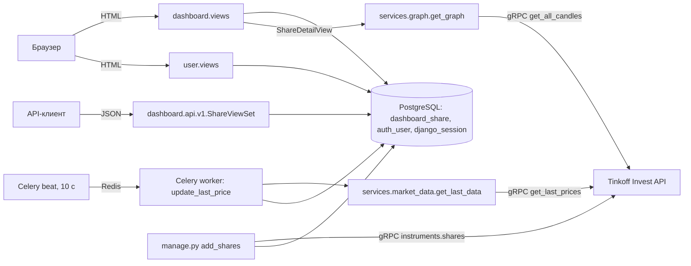

# ANALYSIS.md — Investing Demo

## 1. Анализ кода

Анализ выполнен только по исходному коду в репозитории, приложение не запускалось. Ссылки даны в формате `файл:строка` → функция или класс.

### 1.1. Назначение приложения и технологический стек

**Назначение.** Это веб-приложение, которое ведёт справочник акций и показывает по ним рыночные данные:

- список акций с текущей ценой и признаком роста или падения цены. Ячейка с ценой подсвечена зелёным или красным: `dashboard/templates/dashboard/list.html:35-40`, `dashboard/views.py:20` → `ShareListView`;
- карточка акции с графиком цен закрытия за последние 180 дней: `dashboard/views.py:29` → `ShareDetailView.get`, `dashboard/services/graph.py:11` → `get_graph`;
- создание, редактирование и удаление акций. Доступно только авторизованным пользователям: `dashboard/views.py:41-63` → `ShareCreateView`, `ShareUpdateView`, `ShareDeleteView`;
- REST API для CRUD-операций над акциями: `dashboard/api/v1/views.py:16` → `ShareViewSet`;
- регистрация, вход и выход пользователей: `user/views.py` → `AuthView`, `RegistrationView`, `LogoutView`;
- первичная загрузка справочника акций из Tinkoff Invest API: `dashboard/management/commands/add_shares.py:8` → `Command.handle`;
- периодическое обновление последней цены через Celery: `dashboard/tasks.py:7` → `update_last_price`, `config/celery.py:13` → `app.conf.beat_schedule`.

Источник рыночных данных — **Tinkoff Invest API** (gRPC SDK `tinkoff.invest`). Он используется в трёх местах:

- `dashboard/services/market_data.py` → `get_last_data`;
- `dashboard/services/graph.py` → `get_graph`;
- `dashboard/management/commands/add_shares.py` → `Command.handle`.

Токен хранится в `config/settings.py:134` → `TINKOFF_TOKEN` и там пустой.

**Технологический стек**

| Слой | Технология | Где видно |
|---|---|---|
| Язык | Python 3 | `manage.py`, все `*.py` |
| Веб-фреймворк | Django 4.1.7 | `requirements.txt:13`; комментарии в миграциях `dashboard/migrations/0001_add_share.py:1` |
| REST API | Django REST Framework 3.14 + django-filter 22.1 | `requirements.txt:15-16`; `config/settings.py:31` → `REST_FRAMEWORK` |
| СУБД | PostgreSQL (драйвер psycopg2-binary) | `config/settings.py:91` → `DATABASES`; `docker-compose.yml:3` → сервис `db` |
| Фоновые задачи | Celery 5.2.7 (worker + beat) | `config/celery.py`, `dashboard/tasks.py` |
| Брокер сообщений | Redis | `config/settings.py:141` → `CELERY_BROKER_URL`; `docker-compose.yml:16` → сервис `redis` |
| Рыночные данные | `tinkoff-investments==0.2.0b50` (gRPC, protobuf) | `requirements.txt:36`, `dashboard/services/*.py` |
| Графики | Plotly 5.13 (`plotly.offline.plot`, вывод HTML-`div`) | `dashboard/services/graph.py:21` |
| UI | Шаблоны Django, Bootstrap 5.1.3 (локальная статика), django-crispy-forms 2.0 с пакетом шаблонов `bootstrap3` | `dashboard/templates/**`, `dashboard/static/dashboard/css/bootstrap.min.css`, `config/settings.py:28-29` |
| Инфраструктура | Docker Compose (только PostgreSQL и Redis, контейнера с приложением нет) | `docker-compose.yml` |
| Тесты | DRF `APITestCase` | `dashboard/tests.py:8` → `DashboardTests` |

### 1.2. Структура проекта и основные компоненты

```
config/                Django-проект (настройки, корневой роутинг, Celery, WSGI/ASGI)
  settings.py          настройки: приложения, БД, DRF, логирование, Celery, TINKOFF_TOKEN
  urls.py              корневой URLconf
  celery.py            экземпляр Celery и расписание beat
  __init__.py          экспорт celery_app (загрузка Celery при старте Django)
  wsgi.py / asgi.py    точки входа WSGI/ASGI
dashboard/             основное приложение «акции»
  models.py            модель Share
  views.py             HTML-представления (CBV) и миксин доступа
  forms.py             ShareModelForm
  urls.py              маршруты HTML-части и подключение API
  admin.py             регистрация Share в админке
  tasks.py             Celery-задача update_last_price
  services/
    market_data.py     получение последней цены (Tinkoff)
    graph.py           построение графика свечей (Tinkoff + Plotly)
  api/                 REST API: версия v1 (router, serializer, views, urls)
  management/commands/add_shares.py   команда загрузки справочника акций
  migrations/0001..0007               история схемы таблицы Share
  templates/dashboard/  base, list, detail, create, delete
  static/dashboard/css/ bootstrap.min.css, sticky-footer-navbar.css
  tests.py             тесты REST API и главной страницы
user/                  приложение аутентификации
  models.py            алиас User = get_user_model() (своих моделей нет)
  forms.py             RegistrationForm, AuthForm
  views.py             AuthView, RegistrationView, LogoutView
  urls.py              login/, registration/, logout/
  templates/user/      base, auth, registration
  static/user/css/     bootstrap.min.css, signin.css
docker-compose.yml     PostgreSQL + Redis
requirements.txt       зафиксированные версии зависимостей
README.md              инструкции по запуску
```

**Компоненты и их назначение**

| Компонент | Файл → класс/функция | Назначение |
|---|---|---|
| Настройки | `config/settings.py` | `INSTALLED_APPS` (стр. 13), `DATABASES` (стр. 91), `REST_FRAMEWORK` (стр. 31), `LOGGING` + глобальный `logger` (стр. 37, 59), `TINKOFF_TOKEN` (стр. 134), `CELERY_*` (стр. 137-144) |
| Корневой роутинг | `config/urls.py:4` → `urlpatterns` | `admin/` → админка; `""` → `dashboard.urls`; `"user"` → `user.urls` |
| Celery-приложение | `config/celery.py:7` → `app` | конфигурация из настроек с префиксом `CELERY`, `autodiscover_tasks()`, расписание `beat_schedule` |
| Модель акции | `dashboard/models.py:4` → `Share` | единственная прикладная сущность |
| HTML CRUD | `dashboard/views.py` → `ShareListView`, `ShareDetailView`, `ShareCreateView`, `ShareUpdateView`, `ShareDeleteView` | веб-интерфейс |
| Контроль доступа | `dashboard/views.py:11` → `IsUserAuthenticatedMixin` | `test_func` проверяет `is_authenticated`, `handle_no_permission` перенаправляет на `dashboard:index` |
| Форма акции | `dashboard/forms.py:6` → `ShareModelForm` | `ModelForm` со всеми редактируемыми полями (`fields="__all__"`) |
| REST API | `dashboard/api/v1/views.py:16` → `ShareViewSet`; `serializer.py:6` → `ShareSerializer`; `router.py:5` → `DefaultRouter` | CRUD `/api/v1/shares/` с фильтрацией, поиском и сортировкой |
| Сервис цен | `dashboard/services/market_data.py:6` → `get_last_data` | последняя цена по FIGI |
| Сервис графика | `dashboard/services/graph.py:11` → `get_graph` | дневные свечи за 180 дней → Plotly `div` |
| Фоновое обновление | `dashboard/tasks.py:7` → `update_last_price` | обходит все акции и сохраняет `last_price` и `is_trend_high` |
| Импорт справочника | `dashboard/management/commands/add_shares.py:8` → `Command` | `python manage.py add_shares` |
| Админка | `dashboard/admin.py:6` → `ShareAdmin` | список, поиск и форма редактирования акций |
| Аутентификация | `user/views.py`, `user/forms.py` | вход, регистрация и выход на основе `django.contrib.auth` |

### 1.3. Архитектура и взаимодействие компонентов

Это монолитное Django-приложение по схеме MTV (Model–Template–View). Логика работы с внешним API вынесена в простой сервисный слой `dashboard/services`. Приложение работает в трёх процессах:

1. **Веб-процесс Django** (`config/wsgi.py` → `application`). Отдаёт HTML-страницы и REST API.
2. **Celery beat** (`config/celery.py:13` → `beat_schedule`). Каждые **10 секунд** ставит в очередь задачу `dashboard.tasks.update_last_price`. Ключ расписания называется `"add-every-5-min"`, но значение `schedule` равно `10.0` секундам.
3. **Celery worker**. Выполняет `update_last_price` (`dashboard/tasks.py:7`). Брокер — Redis (`config/settings.py:141`).

Есть и разовый процесс: management-команда `add_shares`.



**Ключевые взаимодействия**

- **Цена хранится в БД, график строится на лету.** Страница списка читает `last_price` и `is_trend_high` из БД (`list.html:35-40`), а эти поля пишет фоновая задача (`tasks.py:24` → `Share.objects.filter(id=...).update(...)`). Страница карточки при каждом запросе синхронно обращается к Tinkoff за свечами (`views.py:37` → `get_graph(share)`). Исторические цены в БД не сохраняются.
- **Как вычисляется тренд.** Функция `update_last_price` сравнивает ранее сохранённую `share.last_price` с новой ценой. Если старая цена больше новой, записывается `is_trend_high=False`, иначе `True`. Если старой цены нет, сравнение с `None` бросает исключение, оно логируется и `is_trend_high` становится `True` (`tasks.py:15-22`).
- **Что работает без доступа к Tinkoff Invest API** (например, при пустом `TINKOFF_TOKEN`):
  - **Список акций** (`ShareListView`), CRUD-формы, админка и REST API работают. Они читают и пишут только БД и к Tinkoff не обращаются. Колонка «Текущая цена» при этом остаётся пустой: `update_last_price` падает на каждой акции, исключение логируется (`tasks.py:27-28`), и `last_price` не заполняется.
  - **Страница акции** (`ShareDetailView.get`) не работает. Она безусловно вызывает `get_graph(share)` (`views.py:37`), а ошибка gRPC-клиента в `get_graph` (`graph.py:12-18`) нигде не перехватывается, поэтому пользователь получает HTTP 500.
  - **Команда `add_shares`** не работает, а без неё справочник акций изначально пуст.
- **Точность цены.** И `get_last_data` (`market_data.py:11` → `resp.price.units`), и `get_graph` (`graph.py:20` → `candle.close.units`) берут только целую часть `Quotation`. Дробная часть (`nano`) отбрасывается.
- **Поле `updated_at` не меняется при обновлении цены.** `QuerySet.update()` в `tasks.py:24` не вызывает `save()`, поэтому `auto_now` у `updated_at` (`models.py:17`) не срабатывает. Поле меняется только при сохранении через форму, админку или API.
- **Логирование.** Используется общий объект `logger` из `config/settings.py:59`. Его напрямую импортируют `dashboard/tasks.py:4` и `dashboard/services/market_data.py:3`. Логи пишутся в консоль и в файл `app.logs` (`settings.py:48-52`).
- **Загрузка Celery вместе с Django.** Файл `config/__init__.py:1` импортирует `celery_app`, поэтому `@app.task` регистрируется при загрузке Django.

**Маршрутизация (итоговые URL)**

| URL | Обработчик | Имя маршрута |
|---|---|---|
| `/` | `dashboard.views.ShareListView` | `dashboard:index` |
| `/<pk>` | `dashboard.views.ShareDetailView` | `dashboard:detail` |
| `/create` | `dashboard.views.ShareCreateView` | `dashboard:create` |
| `/update/<pk>` | `dashboard.views.ShareUpdateView` | `dashboard:update` |
| `/delete/<pk>` | `dashboard.views.ShareDeleteView` | `dashboard:delete` |
| `/api/v1/` | корень `DefaultRouter` | `api-root` |
| `/api/v1/shares/`, `/api/v1/shares/<pk>/` | `dashboard.api.v1.views.ShareViewSet` | `share-list`, `share-detail` |
| `/userlogin/` | `user.views.AuthView` | `user:auth` |
| `/userregistration/` | `user.views.RegistrationView` | `user:registration` |
| `/userlogout/` | `user.views.LogoutView` | `user:logout` |
| `/admin/` | `django.contrib.admin` | — |

Маршрут `/api/` подключён внутри `dashboard/urls.py:19`, а не в корневом URLconf. Маршруты пользователя склеиваются без слэша, получается `/userlogin/`, потому что в `config/urls.py:7` указан префикс `path("user", ...)` без завершающего `/`.

### 1.4. Библиотеки и внешние зависимости

**Python-пакеты** (`requirements.txt`). Напрямую в коде используются:

| Пакет | Версия | Где используется |
|---|---|---|
| Django | 4.1.7 | весь проект |
| djangorestframework | 3.14.0 | `dashboard/api/v1/*`, `dashboard/tests.py` |
| django-filter | 22.1 | `dashboard/api/v1/views.py:1` → `ShareFilter`, `DjangoFilterBackend` |
| django-crispy-forms | 2.0 | `config/settings.py:20`; `dashboard/templates/dashboard/create.html:8` → `as_crispy_field` |
| crispy-bootstrap3 | 2022.1 | `config/settings.py:21, 28-29` (пакет шаблонов форм) |
| celery | 5.2.7 | `config/celery.py`, `dashboard/tasks.py` |
| redis | 4.5.1 | транспорт брокера Celery (`CELERY_BROKER_URL`) |
| psycopg2-binary | 2.9.5 | драйвер `django.db.backends.postgresql` |
| plotly | 5.13.1 | `dashboard/services/graph.py:3-4` |
| tinkoff-investments | 0.2.0b50 | `tinkoff.invest.Client`, `CandleInterval`, `utils.now` в `services/*.py` и `add_shares.py` |
| grpcio, protobuf | 1.51.3, 3.20.3 | транзитивные зависимости `tinkoff-investments` |

Остальное — транзитивные зависимости: `amqp`, `kombu`, `billiard`, `vine`, `click*` от Celery; `asgiref`, `sqlparse` от Django; `pydantic`, `cachetools`, `python-dateutil` и другие. Кроме того, в файл попали инструменты разработчика `black`, `isort`, `mypy-extensions`, `pathspec`, `platformdirs`, `tomli` и пакет `tinkoff==0.1.1`, который в коде не импортируется. Пакет `eventlet` упомянут в `README.md:19` для запуска worker под Windows, но в `requirements.txt` его нет.

**Внешние сервисы и инфраструктура**

- PostgreSQL: `docker-compose.yml:3` → `db`, образ `postgres` без фиксированной версии, БД `investing`, пользователь и пароль `postgres/postgres`, порт 5432. Тома для данных нет; вместо него каталог проекта смонтирован в `/app` контейнера БД (`docker-compose.yml:13-14`).
- Redis: `docker-compose.yml:16` → `redis`, образ `redis`, порт 6379.
- Tinkoff Invest API: сетевой gRPC-доступ по токену `TINKOFF_TOKEN`.

**Внешние фронтенд-ресурсы (CDN)**, `dashboard/templates/dashboard/base.html:10-24`:

- `plotly-latest.min.js`;
- jQuery 3.3.1 slim;
- Popper 1.14.6;
- Font Awesome 4.7.0;
- Moment.js 2.23.0;
- Tempus Dominus Bootstrap 4 5.1.2.

Bootstrap 5.1.3 лежит локально в двух копиях: `dashboard/static/dashboard/css/bootstrap.min.css` и `user/static/user/css/bootstrap.min.css`.

### 1.5. Модель данных

**Сущность `Share` (акция).** Таблица `dashboard_share`, класс `dashboard/models.py:4`. В `Meta` заданы `verbose_name="Акция"` и `verbose_name_plural="Акции"`.

| Атрибут | Тип | Ограничения | Назначение |
|---|---|---|---|
| `id` | `BigAutoField` | PK (`dashboard/apps.py:5`, `settings.py:132`) | суррогатный ключ |
| `figi` | `CharField(255)` | `unique=True` | идентификатор инструмента FIGI, по нему идут запросы к Tinkoff |
| `isin` | `CharField(255)` | обязательное | международный код ISIN |
| `name` | `CharField(255)` | обязательное | «Наименование компании» |
| `ticker` | `CharField(10)` | `unique=True` | «Тикер» |
| `currency` | `CharField(20)` | обязательное | «Валюта» |
| `uid` | `CharField(255)` | `unique=True`, обязательное | внутренний UID инструмента в Tinkoff |
| `last_price` | `FloatField` | `null=True, blank=True` | «Текущая цена» |
| `is_trend_high` | `BooleanField` | `null=True, blank=True` | «Растет цена»: направление последнего изменения |
| `updated_at` | `DateTimeField(auto_now=True)` | `null=True, blank=True` | время последнего сохранения через `save()` |

Схема складывалась миграциями:

- `0001_add_share`: базовые поля;
- `0002_update_share`: уникальность `figi` и `ticker`;
- `0003_add_uuid`: поле `uid`;
- `0004_add_last_price`: поля `last_price` и `is_trend_high`;
- `0005`, `0006`: только `verbose_name`;
- `0007_add_updated_at`: поле `updated_at`.

**Пользователь.** Своей модели нет. `user/models.py:3` → `User = get_user_model()`, то есть используется стандартная `django.contrib.auth.models.User` (таблица `auth_user`). При регистрации email записывается и в `username`, и в `email`: `user/forms.py:51` → `User.objects.create_user(email, email, password)`.

**Связи.** Между `Share` и `User` связей нет: ни одного `ForeignKey`, `ManyToMany` или `OneToOne` в проекте. Пользователи не владеют акциями, все акции общие. Прочие таблицы стандартные для подключённых `django.contrib.*`: сессии, права, `contenttypes`, журнал админки.

### 1.6. Обработка пользовательских запросов и взаимодействие с БД

**Общий конвейер.** Запрос проходит стандартный список `MIDDLEWARE` (`config/settings.py:61`): Security, Session, Common, CSRF, Authentication, Messages, XFrame. Затем он попадает в URLconf (`config/urls.py`) и в CBV или ViewSet. Доступ к БД идёт только через Django ORM; «сырого» SQL в проекте нет.

**HTML-часть (`dashboard/views.py`)**

| Представление | Запрос | Работа с БД и логика |
|---|---|---|
| `ShareListView` (`ListView`) | GET `/` | `Share.objects.order_by("name")` (`ordering`), пагинация по 100 записей (`paginate_by`), шаблон `list.html`. Кнопки управления видны только при `user.is_authenticated` |
| `ShareDetailView.get` | GET `/<pk>` | `Share.objects.get(id=pk)` (`views.py:32`). Если записи нет, `DoesNotExist` не перехватывается, и ответ будет 500, а не 404. Затем вызывается `get_graph(share)` с запросом к Tinkoff. HTML графика выводится через `` (`detail.html:23`) |
| `ShareCreateView` (`CreateView`) | GET/POST `/create` | Проверка `IsUserAuthenticatedMixin`. При POST `ShareModelForm` проверяет данные (обязательность, уникальность `figi`/`ticker`/`uid`) и выполняет `form.save()`, то есть INSERT. Затем редирект на `dashboard:index` |
| `ShareUpdateView` (`UpdateView`) | GET/POST `/update/<pk>` | `get_object()` по `pk` (404, если записи нет), валидация формы, `save()` (UPDATE, обновляет `updated_at`) |
| `ShareDeleteView` (`DeleteView`) | GET/POST `/delete/<pk>` | GET показывает подтверждение (`delete.html`), POST выполняет DELETE |

Неавторизованный пользователь на защищённых страницах не получает 403: `IsUserAuthenticatedMixin.handle_no_permission` (`views.py:15-17`) молча перенаправляет его на главную.

**REST API (`dashboard/api/v1/views.py:16` → `ShareViewSet`, `ModelViewSet`)**

- Методы: `list`, `retrieve`, `create`, `update`, `partial_update`, `destroy` на `/api/v1/shares/` и `/api/v1/shares/<pk>/`. Набор записей — `Share.objects.all()`.
- Сериализация: `ShareSerializer` (`serializer.py:6`) отдаёт поля `id, figi, isin, name, ticker, currency, last_price, is_trend_high, updated_at`. Поля `uid` в нём нет. При создании через API оно получает значение по умолчанию `""`, поэтому вторая запись, созданная через API, нарушит `unique` у `uid`.
- Фильтрация, поиск, сортировка: `ShareFilter` (`views.py:10`) фильтрует по точному совпадению `name` и `ticker` (`?name=`, `?ticker=`); `OrderingFilter` сортирует по `name` и `ticker` (`?ordering=`); `SearchFilter` с `search_fields=["$name"]` ищет по регулярному выражению в `name` (`?search=`).
- Пагинация: `LimitOffsetPagination` с `PAGE_SIZE=100` (`config/settings.py:32-33`). Ответ имеет вид `{count, next, previous, results}`.
- Права доступа: `permission_classes` не заданы, и в `REST_FRAMEWORK` нет `DEFAULT_PERMISSION_CLASSES`. Значит, действует `AllowAny`: анонимный клиент может создавать, изменять и удалять акции через API, хотя в HTML-части те же операции закрыты `IsUserAuthenticatedMixin`.
- Это поведение (CRUD, 201, 204, 400, 404) проверяется тестами `dashboard/tests.py` → `DashboardTests.test_share_*`.

**Аутентификация (`user/views.py`, `user/forms.py`)**

- `AuthView.post`: форма `AuthForm` не проверяется (`is_valid()` не вызывается). Значения берутся из `form.data`, email приводится к нижнему регистру, затем вызываются `authenticate(...)` и `login(...)`. Последний — запись в `django_session`. После этого редирект на `dashboard:index` или повторный показ формы с ошибкой.
- `RegistrationView.post`: `RegistrationForm.is_valid()` → `clean()` проверяет совпадение паролей и уникальность email (`User.objects.filter(email=email)`). Затем `save()` вызывает `create_user` (INSERT в `auth_user`) и `authenticate`, после чего выполняется `login` и редирект. Особенности:
  - email при регистрации не приводится к нижнему регистру, а при входе приводится (`AuthView.post`);
  - `AUTH_PASSWORD_VALIDATORS` в форме не применяются;
  - при ошибке только в отдельном поле, без общей ошибки формы, `form.errors["__all__"]` (`user/views.py:54`) и `self.cleaned_data["email"]` (`user/forms.py:32`) могут бросить `KeyError`.
- `LogoutView.get`: выполняет `logout(request)` (удаляет сессию) и редирект.

**Фоновые и пакетные операции с БД**

- `update_last_price` (`dashboard/tasks.py:7`): один SELECT `Share.objects.all()`, затем для каждой акции отдельный gRPC-запрос и отдельный `UPDATE ... WHERE id=` (`tasks.py:24`). Получается N+1 запросов к API и N UPDATE за запуск, раз в 10 секунд. Ошибки по каждой акции логируются и не прерывают цикл.
- `add_shares` (`add_shares.py:15`): для каждого инструмента из `client.instruments.shares()` вызывается `Share.objects.get_or_create(...)` по всем шести полям сразу. Если любой атрибут инструмента изменился, `get_or_create` попробует вставить новую строку и упадёт на `unique` по `figi`, `ticker` или `uid`. Транзакции и обработки ошибок нет.

**Конфигурационные моменты, влияющие на запуск**

- `SECRET_KEY = ""` (`config/settings.py:6`): Django не стартует с пустым ключом.
- `TINKOFF_TOKEN = ""` (`settings.py:134`): все обращения к Tinkoff будут отклонены. При этом по условиям задания токен Т-Инвестиций недоступен, и источником данных должно стать публичное API Мосбиржи ISS.
- Параметры БД (`settings.py:96-103`) и брокера (`settings.py:141`) жёстко прописаны в коде, переменные окружения не используются.
- `DEBUG = True` и пустой `ALLOWED_HOSTS` (`settings.py:8-10`).
